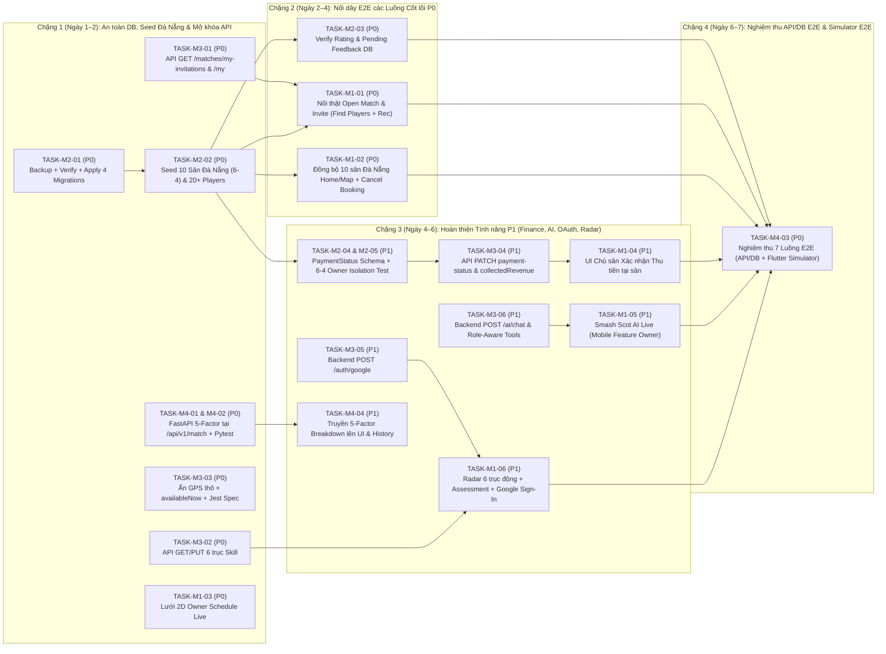

# S-MATCH — FINAL SPRINT EXECUTION BACKLOG (AUDIT V2 — RECONCILED)

**Ngày lập kế hoạch & chuẩn hóa:** 2026-11-09  
**Nhánh Git cơ sở:** `feature/SMM-41-FinalIntegrationTestingRelease`  
**Chế độ kiểm toán:** STRICT READ-ONLY AUDIT MODE (Chỉ cập nhật tài liệu kiểm toán, không tự ý sửa code/DB)  
**Tài liệu đối chiếu gốc:**  
- [FINAL-SPRINT-REQUIREMENT-MATRIX.md](file:///Users/mbp/Documents/WORKSPACE/Capstone/s-match/docs/audits/FINAL-SPRINT-REQUIREMENT-MATRIX.md)  
- [FINAL-SPRINT-COMPLETION-SCORECARD.md](file:///Users/mbp/Documents/WORKSPACE/Capstone/s-match/docs/audits/FINAL-SPRINT-COMPLETION-SCORECARD.md)

---

## 1. Mô Hình Năng Lực Nhóm & Tổng Hợp Phân Công (Team Capacity & Reconciled Task Counts)

### 1.1. Giả định năng lực & Nguyên tắc phân quyền trách nhiệm
- **Quy mô nhóm:** 4 thành viên chuyên trách, quỹ thời gian Sprint cuối từ **7–10 ngày làm việc** (**30–45 giờ/thành viên**, tổng cộng **120–170 giờ**).
- **Nguyên tắc phân định ranh giới kỹ thuật (Role Ownership Boundaries):**
  1. **Member 1 (Mobile Lead):** Phụ trách giao diện Flutter, Riverpod, MapLibre, nối API E2E trên Mobile, và giữ vai trò **Feature Owner của Trợ lý Smash Scot AI** (`REQ-AI-01`).
  2. **Member 2 (Database & Data Integrity Lead):** Phụ trách Prisma Schema, quy trình an toàn Migration (Backup → Kiểm chứng cô lập → Rollback), bộ dữ liệu Seed **10 cơ sở tại Đà Nẵng** (`REQ-FAC-05`), và toàn vẹn dữ liệu Thanh toán / Đánh giá.
  3. **Member 3 (Backend Lead):** Phụ trách NestJS REST API, RBAC, Google OAuth (`REQ-AUTH-04`), API Xác nhận thu tiền tại sân (`REQ-FIN-05`), và **xây dựng các công cụ truy vấn dữ liệu an toàn theo phân quyền (Role-Aware Data Tools) & kết nối LLM API cho Smash Scot** (`REQ-AI-02..04`). *(Lưu ý: Không tạo lại CRUD Facility/Court vì `FacilitiesController`, `OperatingHoursController`, `TimeSlotsController` đã hoàn thiện).*
  4. **Member 4 (Matchmaking & AI Algorithm Lead):** Phụ trách thuật toán xếp hạng **5 yếu tố** (`MatchmakingEngine` tại `POST /api/v1/match`), môi trường Python FastAPI, và điều phối kiểm thử nghiệm thu **API/Database E2E vs. Flutter Simulator E2E**.

### 1.2. Bảng tổng hợp số lượng Task theo Ưu tiên & Thành viên (Reconciled Summary Table)

| Thành viên | Vai trò chính (Role) | Danh sách Task P0 (Critical) | Danh sách Task P1 (Core Functional) | Danh sách Task P2 (Optional / Controlled) | Số lượng Task (P0 / P1 / P2 / Tổng) | Giờ P0 | Giờ P1 | Tổng tải P0+P1 (Giờ / Ngày) |
| :--- | :--- | :--- | :--- | :--- | :---: | :---: | :---: | :---: |
| **Member 1** | **Mobile Lead** *(Flutter, MapLibre, Smash Scot AI Feature Owner)* | `TASK-M1-01` `TASK-M1-02` `TASK-M1-03` | `TASK-M1-04` `TASK-M1-05` `TASK-M1-06` | Phối hợp `TASK-OPT-01`, `TASK-OPT-02` *(nếu bật)* | **3 P0 / 3 P1 / 0 P2** *(6 Tasks)* | 24 – 32h | 16 – 22h | **40 – 54h** *(~5.5 – 7 ngày)* |
| **Member 2** | **Database & Data Integrity Lead** *(Prisma, Safe Migrations, Da Nang Seed)* | `TASK-M2-01` `TASK-M2-02` `TASK-M2-03` | `TASK-M2-04` `TASK-M2-05` | — | **3 P0 / 2 P1 / 0 P2** *(5 Tasks)* | 14 – 20h | 10 – 14h | **24 – 34h** *(~3.5 – 5 ngày)* |
| **Member 3** | **Backend Lead** *(NestJS, Google OAuth, Finance API, Secure AI Tools)* | `TASK-M3-01` `TASK-M3-02` `TASK-M3-03` | `TASK-M3-04` `TASK-M3-05` `TASK-M3-06` | `TASK-OPT-01` `TASK-OPT-02` *(Optional)* | **3 P0 / 3 P1 / 2 P2** *(6 Core + 2 Opt)* | 13 – 19h | 19 – 25h | **32 – 44h** *(~4.5 – 6 ngày)* |
| **Member 4** | **Matchmaking & QA Lead** *(FastAPI 5-Factor Engine, Simulator E2E)* | `TASK-M4-01` `TASK-M4-02` `TASK-M4-03` | `TASK-M4-04` | — | **3 P0 / 1 P1 / 0 P2** *(4 Tasks)* | 17 – 22h | 5 – 8h | **22 – 30h** *(~3.5 – 4.5 ngày)* |
| **TỔNG CỘNG** | **Toàn nhóm (4 Thành viên)** | **12 Tasks P0** | **9 Tasks P1** | **2 Tasks P2 (Kiểm soát phạm vi)** | **12 P0 / 9 P1 / 2 P2 (Tổng: 23 Tasks)** | **68 – 93h** | **50 – 69h** | **118 – 162h** *(+ 0–12h P2 tùy chọn)* |

---

## 2. Đặc Tả Chi Tiết Từng Công Việc (Complete Task Specifications)

Mọi công việc dưới đây đều có đầy đủ: Mã Task, Mức ưu tiên, Mô tả, Mã yêu cầu gốc (`Requirement IDs`), Bằng chứng hiện tại, File tác động, Người phụ trách (`Owner`), Phụ thuộc (`Dependencies`), Hợp đồng API/Schema, Tiêu chí nghiệm thu (`Acceptance Criteria`), Ước lượng giờ và Kế hoạch kiểm thử (`Test Plan & DoD`).

---

### PHẦN A — MEMBER 2: DATABASE & DATA INTEGRITY LEAD

#### `TASK-M2-01` [P0] Thực thi Quy trình An toàn Migration (Backup, Kiểm chứng cô lập, Rollback) & Áp dụng 4 bản Migration đang chờ
- **Mô tả:** Sao lưu cơ sở dữ liệu hiện hành, kiểm chứng chuỗi 15 bản migration trên một database tạm cô lập (đặc biệt kiểm tra bảng `TimeSlot` qua hai migration `20261006024604` và `20261014065156`), chuẩn bị script rollback rồi mới áp dụng 4 bản migration đang chờ (`20261027120000_add_match_feedback`, `20261027120000_smm_36_community_rating`, `20261027130000_smm_36_rating_history`, `20261101120000_smm_40_analytics_indexes`).
- **Source Requirement IDs:** `REQ-OPS-02`, `REQ-RATE-01`, `REQ-RATE-02`, `REQ-RATE-03`, `REQ-FIN-01`
- **Bằng chứng hiện tại:** `npx prisma migrate status` báo 4 migrations chưa được apply trên Docker PostgreSQL (`:5433`); migration `20261006024604` chứa lệnh `DROP TABLE "TimeSlot"` trước khi `20261014065156` tạo lại.
- **Files / Modules tác động:**
  - `backend/prisma/schema.prisma`
  - `backend/prisma/migrations/*`
  - `backend/prisma/INTEGRATION_NOTES.md`
- **Owner:** Member 2 (Database Lead)
- **Dependencies:** Không (Task mở đầu đường găng, cần nhóm phê duyệt bản backup trước khi chạy trên DB chính).
- **Hợp đồng Schema & Quy trình (Schema & Safety Contract):**
  1. Chạy `pg_dump` lưu bản sao lưu đầy đủ trước khi can thiệp.
  2. Dựng DB tạm (`smatch_migration_verify`), chạy `npx prisma migrate deploy` để xác minh toàn bộ bảng (`User`, `PlayerProfile`, `Skill`, `Facility`, `Court`, `TimeSlot`, `OperatingHours`, `Booking`, `Match`, `MatchParticipant`, `Feedback`, `PlayerRating`, `RatingHistory`, `RecommendationSession`, `RecommendationResult`) tồn tại đầy đủ.
  3. Viết script SQL rollback cho 4 bản migration mới.
- **Tiêu chí nghiệm thu (Acceptance Criteria):**
  1. Có file backup `.sql` và script rollback được kiểm duyệt.
  2. `npx prisma migrate deploy` chạy thành công không mất dữ liệu `Booking` hay `TimeSlot`.
  3. `npx prisma migrate status` trả về `Database schema is up to date!`.
- **Ước lượng nỗ lực:** `4 – 6 giờ` (0.5 – 1 ngày).
- **Kế hoạch kiểm thử & DoD:** Chạy `npx prisma migrate status` và truy vấn kiểm tra cấu trúc các bảng `Feedback`, `PlayerRating`, `RatingHistory`, `TimeSlot`.

---

#### `TASK-M2-02` [P0] Mở rộng `seed.ts` lên chuẩn 10 Cơ sở Cầu lông tại Đà Nẵng (2 Chủ sân tỷ lệ 6–4, 24–46 Sân con, 20+ Người chơi)
- **Mô tả:** Nâng cấp file `backend/prisma/seed.ts` để khởi tạo đầy đủ **10 cơ sở cầu lông tại TP. Đà Nẵng** (khớp chính xác với 10 cơ sở Đà Nẵng trong thiết kế Figma Sprint 10 và `DemoCatalog`), phân bổ cho **2 Chủ sân theo tỷ lệ 6–4**, kèm các sân con, khung giờ `TimeSlot`, và **20+ người chơi tại Đà Nẵng** có đầy đủ hồ sơ kỹ năng 6 trục.
- **Source Requirement IDs:** `REQ-FAC-05`, `REQ-FAC-01`, `REQ-FAC-04`, `REQ-OPS-02`
- **Bằng chứng hiện tại:** [seed.ts](file:///Users/mbp/Documents/WORKSPACE/Capstone/s-match/backend/prisma/seed.ts#L109-L122) hiện chỉ tạo 1 Chủ sân (`owner@smatch.dev`), 1 Cơ sở (`id: 1`, `123 Nguyễn Văn Linh, Đà Nẵng`), 4 Courts và 4 Players; trong khi [demo_catalog.dart](file:///Users/mbp/Documents/WORKSPACE/Capstone/s-match/mobile/lib/features/player_experience/data/demo_catalog.dart#L83-L184) liệt kê 10 cơ sở tại Đà Nẵng với ID âm (`-1001`..`-1010`).
- **Files / Modules tác động:**
  - `backend/prisma/seed.ts`
  - `backend/prisma/INTEGRATION_NOTES.md`
- **Owner:** Member 2 (Database Lead)
- **Dependencies:** `TASK-M2-01`
- **Hợp đồng dữ liệu (Data Contract):**
  - **2 Chủ sân (COURT_OWNER):**
    - `owner@smatch.dev` (hoặc `owner1@smatch.dev`): sở hữu **6 cơ sở Đà Nẵng (`id: 1..6`)**: `Hai Chau Badminton` (`16.061, 108.2165`), `Hoa Cuong Badminton` (`16.034, 108.215`), `Thanh Khe Badminton` (`16.064, 108.185`), `An Khe Badminton` (`16.045, 108.178`), `An Hai Badminton` (`16.065, 108.241`), `Son Tra Badminton` (`16.093, 108.246`).
    - `owner2@smatch.dev`: sở hữu **4 cơ sở Đà Nẵng (`id: 7..10`)**: `Ngu Hanh Son Badminton` (`16.012, 108.258`), `Hoa Xuan Badminton` (`15.999, 108.220`), `Cam Le Badminton` (`16.012, 108.192`), `Hoa Khanh Badminton` (`16.073, 108.152`).
  - **Sân con (`Court`), Giờ mở cửa (`OperatingHours`) & Khung giờ (`TimeSlot`):** Tạo 3–6 sân mỗi cơ sở (tổng 30–46 sân), cấu hình giờ mở cửa `06:00–22:00` cho cả 7 ngày trong tuần và bảng giá `TimeSlot` (`70.000đ – 120.000đ/giờ`).
  - **20+ Người chơi (`PLAYER`):** Tạo 20+ tài khoản quanh các quận Đà Nẵng kèm `PlayerProfile`, `PlayingPreference`, `Availability` và bản ghi `Skill` với đúng 6 trường trong Prisma schema: `smash`, `defense`, `netPlay`, `stamina`, `footwork`, `serve` (thang `1.0–5.0`).
  - Đảm bảo tính **idempotent** (`upsert`) và cập nhật PostgreSQL sequence (`setval`) cho `Facility`, `Court`, `TimeSlot`.
- **Tiêu chí nghiệm thu (Acceptance Criteria):**
  1. `npx prisma db seed` chạy thành công, idempotent (chạy lại nhiều lần không lỗi trùng khóa).
  2. `GET /facilities` trả về đúng 10 cơ sở tại Đà Nẵng với ID dương `1..10`.
  3. `GET /facilities/my` trả về đúng 6 cơ sở cho Owner 1 và 4 cơ sở cho Owner 2.
- **Ước lượng nỗ lực:** `6 – 8 giờ` (1 ngày).
- **Kế hoạch kiểm thử & DoD:** Kiểm tra số lượng bản ghi trong DB (`facilities = 10`, `owners = 2`, `players >= 20`) và xác nhận qua `GET /facilities`.

---

#### `TASK-M2-03` [P0] Kiểm chứng toàn vẹn dữ liệu Đánh giá Cộng đồng (`PlayerRating`, `RatingHistory`, `Feedback`) & Lịch sử Gợi ý (`RecommendationSession`)
- **Mô tả:** Xác minh các ràng buộc khóa ngoại, unique index và truy vấn tổng hợp điểm uy tín (`reliabilityScore`, `communityRating`) sau khi áp dụng 3 bản migration đánh giá `20261027*` và bổ sung dữ liệu mẫu đánh giá/lịch sử gợi ý vào `seed.ts`.
- **Source Requirement IDs:** `REQ-RATE-01`, `REQ-RATE-02`, `REQ-RATE-03`, `REQ-RATE-04`, `REQ-MM-04`
- **Bằng chứng hiện tại:** Code trong `RatingsService` và `ApiFeedbackRepository` đã khớp hợp đồng nhưng chưa có dữ liệu seed mẫu trong bảng `PlayerRating` và `RatingHistory` do migration chưa chạy.
- **Files / Modules tác động:**
  - `backend/prisma/seed.ts`
  - `backend/src/ratings/ratings.service.ts`
- **Owner:** Member 2 (Database Lead)
- **Dependencies:** `TASK-M2-01`, `TASK-M2-02`
- **Hợp đồng dữ liệu (Data Contract):**
  - Tạo ít nhất 2 trận đấu ở trạng thái `COMPLETED` (1 trận đã có đánh giá trong `PlayerRating` + `RatingHistory`, 1 trận vừa kết thúc để người chơi demo thấy ngay trong `GET /ratings/pending`).
- **Tiêu chí nghiệm thu (Acceptance Criteria):**
  1. `GET /ratings/users/:userId/summary` và `GET /ratings/users/:userId/history` trả về dữ liệu thật từ DB.
  2. `GET /ratings/pending` trả về trận đấu đã hoàn thành nhưng chưa chấm điểm cho tài khoản `player@smatch.dev`.
- **Ước lượng nỗ lực:** `4 – 6 giờ` (0.5 – 1 ngày).
- **Kế hoạch kiểm thử & DoD:** Chạy kiểm thử tích hợp trên PostgreSQL cho `POST /ratings` và `GET /ratings/pending`.

---

#### `TASK-M2-04` [P1] Bổ sung `PaymentStatus` vào Prisma Schema & Migration cho Quy trình Thanh toán tại sân
- **Mô tả:** Tách bạch trạng thái đặt sân (`BookingStatus`) và trạng thái thanh toán (`PaymentStatus`) trong bảng `Booking` để phục vụ quy trình Chủ sân xác nhận thu tiền tại sân (Pay-at-court workflow) và tính toán doanh thu thực thu (`collectedRevenue`).
- **Source Requirement IDs:** `REQ-FIN-04`, `REQ-FIN-05`, `REQ-FIN-06`
- **Bằng chứng hiện tại:** [schema.prisma](file:///Users/mbp/Documents/WORKSPACE/Capstone/s-match/backend/prisma/schema.prisma#L226-L248) hiện chỉ có `status BookingStatus @default(CONFIRMED)` mà chưa có `paymentStatus`, khiến `RevenueAnalyticsService` phải trả về `collectedRevenue: null`.
- **Files / Modules tác động:**
  - `backend/prisma/schema.prisma`
  - `backend/prisma/migrations/*` (migration mới có kèm script rollback)
  - `backend/prisma/seed.ts`
- **Owner:** Member 2 (Database Lead)
- **Dependencies:** `TASK-M2-01`
- **Hợp đồng Schema (Schema Contract):**
  - Định nghĩa `enum PaymentStatus { UNPAID PAID PENDING CANCELLED }`.
  - Bổ sung vào model `Booking`: `paymentStatus PaymentStatus @default(UNPAID)` và `paidAt DateTime?`, kèm index `@@index([courtId, paymentStatus, startTime])`.
  - Cập nhật `seed.ts` để tạo cả đơn `PAID` và `UNPAID` cho 2 Chủ sân tại Đà Nẵng.
- **Tiêu chí nghiệm thu (Acceptance Criteria):**
  1. Migration mới chạy an toàn không làm mất dữ liệu `Booking` hiện có (mặc định gán `UNPAID`).
  2. Prisma Client sinh kiểu `PaymentStatus` đầy đủ cho Backend.
- **Ước lượng nỗ lực:** `5 – 7 giờ` (1 ngày).
- **Kế hoạch kiểm thử & DoD:** Kiểm tra schema và chạy test truy vấn tổng tiền theo `paymentStatus = PAID` vs `UNPAID`.

---

#### `TASK-M2-05` [P1] Bổ sung Kiểm thử Cô lập Dữ liệu Chủ sân (6–4 Isolation) & Cờ Đồng thuận Vị trí (`locationSharingConsent`)
- **Mô tả:** Bổ sung trường `locationSharingConsent Boolean @default(false)` vào `PlayerProfile` (phục vụ bảo vệ quyền riêng tư vị trí) và viết bộ kiểm thử dữ liệu xác nhận Owner 1 (6 cơ sở Đà Nẵng) và Owner 2 (4 cơ sở Đà Nẵng) hoàn toàn cô lập về doanh thu và danh sách đặt sân.
- **Source Requirement IDs:** `REQ-MAP-04`, `REQ-FIN-01`, `REQ-FIN-02`
- **Bằng chứng hiện tại:** `PlayerProfile` trong `schema.prisma` chưa có cờ đồng thuận chia sẻ vị trí; dữ liệu seed hiện tại mới có 1 Owner.
- **Files / Modules tác động:**
  - `backend/prisma/schema.prisma`
  - `backend/src/bookings/bookings.integration.live.spec.ts`
- **Owner:** Member 2 (Database Lead)
- **Dependencies:** `TASK-M2-02`, `TASK-M2-04`
- **Hợp đồng Schema (Schema Contract):**
  - Thêm `locationSharingConsent Boolean @default(false)` vào `PlayerProfile` (có thể gộp chung vào migration của `TASK-M2-04` để chỉ chạy 1 lần migration mới).
- **Tiêu chí nghiệm thu (Acceptance Criteria):**
  1. Bài test integration xác nhận Owner 1 gọi `/bookings/owner` và `/analytics/*` chỉ nhận dữ liệu của cơ sở `1..6`; nếu truyền `facilityId=7` của Owner 2 sẽ nhận `403 Forbidden`.
- **Ước lượng nỗ lực:** `5 – 7 giờ` (0.5 – 1 ngày).
- **Kế hoạch kiểm thử & DoD:** Pass 100% trong `bookings.integration.live.spec.ts`.

---

### PHẦN B — MEMBER 3: BACKEND LEAD

#### `TASK-M3-01` [P0] Bổ sung Endpoint Danh sách Lời mời & Trận đấu của tôi (`GET /matches/my-invitations` & `GET /matches/my`)
- **Mô tả:** Bổ sung các endpoint còn thiếu trong `MatchesController` để người chơi lấy danh sách các lời mời tham gia trận đấu (`INVITED`, bao gồm cả trận `PRIVATE`) và danh sách các trận mình làm Host/Member kèm yêu cầu xin vào (`REQUESTED`).
- **Source Requirement IDs:** `REQ-MATCH-01`, `REQ-MATCH-02`, `REQ-MATCH-03`, `REQ-MATCH-04`, `REQ-MATCH-05`
- **Bằng chứng hiện tại:** [matches.controller.ts](file:///Users/mbp/Documents/WORKSPACE/Capstone/s-match/backend/src/matches/matches.controller.ts) đã có `POST /matches`, `GET /matches/open`, `POST /matches/:id/invite`, `POST /matches/:id/join-request`, `PATCH /matches/:id/invitations/accept|reject`, `PATCH /matches/:id/requests/:userId/approve|reject`, nhưng chưa có API trả về danh sách lời mời của người dùng đang đăng nhập.
- **Files / Modules tác động:**
  - `backend/src/matches/matches.controller.ts`
  - `backend/src/matches/matches.service.ts`
  - `backend/src/matches/matches.lifecycle.spec.ts`
- **Owner:** Member 3 (Backend Lead)
- **Dependencies:** Không.
- **Hợp đồng API (API Contract):**
  - `GET /matches/my-invitations`: Yêu cầu JWT (`@UseGuards(JwtAuthGuard)`), trả về danh sách các bản ghi `MatchParticipant` của `req.user.sub` có `status = INVITED`, kèm thông tin `match` (`id`, `title`, `startTime`, `endTime`, `location`, `mode`, `host` profile).
  - `GET /matches/my`: Trả về các trận do `req.user.sub` làm `HOST` (kèm danh sách `participants` đang `REQUESTED`, `INVITED`, `ACCEPTED`) hoặc đã tham gia (`MEMBER` với `status = ACCEPTED`).
- **Tiêu chí nghiệm thu (Acceptance Criteria):**
  1. Người chơi được mời vào trận `PRIVATE` hoặc `OPEN` gọi `GET /matches/my-invitations` thấy đầy đủ lời mời để bấm Accept/Reject.
  2. Host gọi `GET /matches/my` thấy danh sách người chơi đang `REQUESTED` để bấm Approve/Reject.
- **Ước lượng nỗ lực:** `5 – 7 giờ` (1 ngày).
- **Kế hoạch kiểm thử & DoD:** Bổ sung unit test trong `matches.lifecycle.spec.ts` đạt 100% PASS.

---

#### `TASK-M3-02` [P0] Đồng bộ API Kỹ năng 6 trục (`GET /players/profile/me` kèm `skill` & `PUT /players/profile/me/skill`)
- **Mô tả:** Sửa `PlayersService.getMyProfile` để trả kèm quan hệ `skill` và bổ sung endpoint `PUT /players/profile/me/skill` cho phép lưu đúng 6 trục kỹ năng trong Prisma schema (`smash`, `defense`, `netPlay`, `stamina`, `footwork`, `serve`).
- **Source Requirement IDs:** `REQ-PROF-03`, `REQ-PROF-04`
- **Bằng chứng hiện tại:** [schema.prisma](file:///Users/mbp/Documents/WORKSPACE/Capstone/s-match/backend/prisma/schema.prisma#L108-L120) định nghĩa bảng `Skill` gồm 6 trường `smash`, `defense`, `netPlay`, `stamina`, `footwork`, `serve`; nhưng `PlayersService.getMyProfile` chưa `include: { skill: true }` và chưa có endpoint cập nhật bảng `Skill`.
- **Files / Modules tác động:**
  - `backend/src/players/players.controller.ts`
  - `backend/src/players/players.service.ts`
  - `backend/src/players/dto/update-skill.dto.ts` (mới)
- **Owner:** Member 3 (Backend Lead)
- **Dependencies:** Không.
- **Hợp đồng API (API Contract):**
  - `GET /players/profile/me`: Trả thêm đối tượng `skill: { smash, defense, netPlay, stamina, footwork, serve }` (nếu chưa có bản ghi `Skill`, trả giá trị mặc định hoặc `null`).
  - `PUT /players/profile/me/skill`: Nhận DTO gồm đúng 6 trường số thực (`@Min(0) @Max(5)`): `smash`, `defense`, `netPlay`, `stamina`, `footwork`, `serve`; thực hiện `prisma.skill.upsert` theo `playerProfileId`. **Tuyệt đối không thêm trường ngoài schema.**
- **Tiêu chí nghiệm thu (Acceptance Criteria):**
  1. `PUT /players/profile/me/skill` lưu chính xác 6 trục vào bảng `Skill` trong PostgreSQL.
  2. `GET /players/profile/me` trả về đúng 6 chỉ số vừa lưu, và `CandidatesService` đọc được ngay khi ghép trận.
- **Ước lượng nỗ lực:** `4 – 6 giờ` (0.5 – 1 ngày).
- **Kế hoạch kiểm thử & DoD:** Viết unit test cho `getMyProfile` và `updateMySkill` trong `players.service.spec.ts`.

---

#### `TASK-M3-03` [P0] Bảo mật Tọa độ trong `GET /candidates/nearby`, Bổ sung `availableNow` & Viết Unit Test cho `facilities.service.spec.ts`
- **Mô tả:** Loại bỏ tọa độ GPS chính xác (`latitude`, `longitude`) của người chơi khác khỏi response của `GET /candidates/nearby` (trừ khi có cờ đồng thuận), bổ sung trường boolean `availableNow` dựa trên lịch rảnh hiện tại, và viết đầy đủ unit test cho file rỗng `backend/src/facilities/facilities.service.spec.ts`.
- **Source Requirement IDs:** `REQ-MAP-04`, `REQ-MAP-05`, `REQ-OPS-03`, `REQ-OPS-04`
- **Bằng chứng hiện tại:**
  1. [candidates.service.ts](file:///Users/mbp/Documents/WORKSPACE/Capstone/s-match/backend/src/candidates/candidates.service.ts#L109-L117) đang trả trực tiếp `latitude` và `longitude` của ứng viên trong `findNearby`, và chưa trả về `availableNow`.
  2. `backend/src/facilities/facilities.service.spec.ts` đang rỗng `0 byte`, gây lỗi khi chạy `npm test`.
- **Files / Modules tác động:**
  - `backend/src/candidates/candidates.service.ts`
  - `backend/src/candidates/candidates.service.spec.ts`
  - `backend/src/facilities/facilities.service.spec.ts`
- **Owner:** Member 3 (Backend Lead)
- **Dependencies:** Không.
- **Hợp đồng API (API Contract):**
  - Response của `GET /candidates/nearby`: Mỗi phần tử trong `candidates[]` trả về `{ userId, fullName, nickname, skillLevel, distanceKm, availableNow, playingStyle }` — **ẩn `latitude` và `longitude` thô**.
- **Tiêu chí nghiệm thu (Acceptance Criteria):**
  1. `GET /candidates/nearby` không làm lộ tọa độ GPS chính xác của người chơi khác và trả về `availableNow: true/false` để bộ lọc *Available Now* trên Mobile hoạt động ở chế độ Live.
  2. `facilities.service.spec.ts` kiểm thử đầy đủ `createFacility`, `getMyFacilities`, `updateFacility`, `deleteFacility`, `addCourt`, `updateCourt`, `deleteCourt`; toàn bộ unit test Jest trong `backend/src` đạt 100% PASS.
- **Ước lượng nỗ lực:** `4 – 6 giờ` (0.5 – 1 ngày).
- **Kế hoạch kiểm thử & DoD:** Chạy `npx jest src/candidates/candidates.service.spec.ts src/facilities/facilities.service.spec.ts` đạt PASS 100%.

---

#### `TASK-M3-04` [P1] Triển khai API Xác nhận Thu tiền tại sân (`PATCH /bookings/:id/payment-status`) & Tính toán `collectedRevenue` / `outstandingRevenue`
- **Mô tả:** Cung cấp API để Chủ sân (hoặc Admin) xác nhận đã thu tiền đơn đặt sân tại sân (`PAID` / `UNPAID` / `CANCELLED`), đồng thời cập nhật `RevenueAnalyticsService` để tính toán chính xác Doanh thu thực thu (`collectedRevenue`) và Công nợ chưa thu (`outstandingRevenue`).
- **Source Requirement IDs:** `REQ-FIN-04`, `REQ-FIN-05`, `REQ-FIN-06`
- **Bằng chứng hiện tại:** [revenue-analytics.service.ts](file:///Users/mbp/Documents/WORKSPACE/Capstone/s-match/backend/src/analytics/revenue-analytics.service.ts#L88-L90) hiện chỉ tính `grossBookedRevenue` và gán `collectedRevenue: null`.
- **Files / Modules tác động:**
  - `backend/src/bookings/bookings.controller.ts`
  - `backend/src/bookings/bookings.service.ts`
  - `backend/src/bookings/dto/update-payment-status.dto.ts` (mới)
  - `backend/src/analytics/revenue-analytics.service.ts`
  - `backend/src/analytics/revenue-analytics.service.spec.ts`
- **Owner:** Member 3 (Backend Lead)
- **Dependencies:** `TASK-M2-04` (`PaymentStatus` trong Prisma schema)
- **Hợp đồng API (API Contract):**
  - `PATCH /bookings/:id/payment-status`: Chỉ cho phép `COURT_OWNER` sở hữu cơ sở chứa sân của đơn đặt đó (hoặc `ADMIN`) cập nhật `{ paymentStatus: 'PAID' | 'UNPAID' | 'PENDING' | 'CANCELLED' }`, tự động ghi nhận `paidAt`.
  - `GET /analytics/revenue/overview` (và `/analytics/owner/summary`): Trả về `{ grossBookedRevenue, collectedRevenue, outstandingRevenue }` (trong đó `collectedRevenue` là tổng `totalPrice` của các đơn `CONFIRMED`/`COMPLETED` có `paymentStatus = PAID`, và `outstandingRevenue` là tổng các đơn hợp lệ có `paymentStatus IN ('UNPAID', 'PENDING')`).
- **Tiêu chí nghiệm thu (Acceptance Criteria):**
  1. Chủ sân A không thể xác nhận thanh toán cho đơn đặt sân thuộc cơ sở của Chủ sân B (`403 Forbidden`).
  2. Khi chuyển đơn sang `PAID`, `collectedRevenue` tăng đúng bằng `totalPrice` và `outstandingRevenue` giảm tương ứng.
- **Ước lượng nỗ lực:** `6 – 8 giờ` (1 ngày).
- **Kế hoạch kiểm thử & DoD:** Cập nhật `revenue-analytics.service.spec.ts` và `bookings.service.spec.ts` đạt 100% PASS.

---

#### `TASK-M3-05` [P1] Triển khai Xác thực Google OAuth tại Backend (`POST /auth/google`)
- **Mô tả:** Xây dựng endpoint `POST /auth/google` trong `AuthController` để xác thực Google ID Token từ Flutter, tự động tìm hoặc tạo mới `User` (role `PLAYER`) + `PlayerProfile` trong PostgreSQL, lưu `RefreshSession` và trả về cặp JWT Access/Refresh token chuẩn của S-Match.
- **Source Requirement IDs:** `REQ-AUTH-04`
- **Bằng chứng hiện tại:** `AuthController` mới có `/auth/register`, `/auth/login`, `/auth/refresh`, `/auth/logout`; chưa có `/auth/google`.
- **Files / Modules tác động:**
  - `backend/src/auth/auth.controller.ts`
  - `backend/src/auth/auth.service.ts`
  - `backend/src/auth/dto/google-login.dto.ts` (mới)
- **Owner:** Member 3 (Backend Lead)
- **Dependencies:** Không.
- **Hợp đồng API (API Contract):**
  - `POST /auth/google`: Nhận `{ idToken: string }`, xác minh chữ ký và `aud`/`email_verified` của Google token, upsert `User` theo `email`, tạo `RefreshSession` và trả về `{ access_token, refresh_token, user: { id, email, fullName, role } }` giống hệt `POST /auth/login`.
- **Tiêu chí nghiệm thu (Acceptance Criteria):**
  1. Token Google hợp lệ đăng nhập thành công và dùng được `access_token` cho mọi API có `@UseGuards(JwtAuthGuard)`.
  2. Token giả mạo hoặc hết hạn bị từ chối với `401 Unauthorized`.
- **Ước lượng nỗ lực:** `5 – 7 giờ` (0.5 – 1 ngày).
- **Kế hoạch kiểm thử & DoD:** Viết unit test với mock Google verifier trong `auth.service.spec.ts`.

---

#### `TASK-M3-06` [P1] Xây dựng Module Backend `POST /ai/chat` & Công cụ Truy vấn Dữ liệu Phân quyền (Role-Aware AI Tools) cho Smash Scot
- **Mô tả:** Tạo module `backend/src/ai/` cung cấp endpoint `POST /ai/chat` (yêu cầu JWT), kết nối LLM API kèm hệ thống Function/Tool Calling truy vấn dữ liệu thực tế từ PostgreSQL theo đúng vai trò (`PLAYER`, `COURT_OWNER`, `ADMIN`) và chống bịa đặt dữ liệu (hallucination prevention).
- **Source Requirement IDs:** `REQ-AI-02`, `REQ-AI-03`, `REQ-AI-04`
- **Bằng chứng hiện tại:** Backend chưa có module `src/ai/`; các service dữ liệu nền (`TimeSlotsService`, `CandidatesService`, `MatchesService`, `RevenueAnalyticsService`, `BookingsService`) đã có sẵn.
- **Files / Modules tác động:**
  - `backend/src/ai/ai.module.ts` (mới)
  - `backend/src/ai/ai.controller.ts` (mới)
  - `backend/src/ai/ai.service.ts` (mới)
  - `backend/src/ai/ai-tools.service.ts` (mới)
- **Owner:** Member 3 (Backend Lead)
- **Dependencies:** `TASK-M2-02`
- **Hợp đồng API & Bảo mật (API & RBAC Contract):**
  - `POST /ai/chat`: Nhận `{ message: string, conversationHistory?: [...] }`, đọc `userId` và `role` từ JWT (`req.user`).
  - **Tools cho `PLAYER` (`REQ-AI-03`):** `searchAvailableCourts(date, district)`, `findNearbyPlayers(radiusKm)`, `listOpenMatches()`, `listShopsAndCourses()`.
  - **Tools cho `COURT_OWNER` (`REQ-AI-04`):** `getMyFacilityRevenue(range)` và `getMyFacilityBookings(date, facilityId)` — **bắt buộc truyền `ownerId = req.user.sub`**, tuyệt đối không cho phép truy vấn cơ sở của Chủ sân khác.
  - **Tools cho `ADMIN` (`REQ-AI-04`):** `getSystemAnalyticsOverview(range)`.
  - Trả về `{ reply: string, citations: [...], suggestedActions: [...] }`. Nếu không có dữ liệu trong DB, trả lời trung thực là không tìm thấy bản ghi.
- **Tiêu chí nghiệm thu (Acceptance Criteria):**
  1. `PLAYER` hỏi sân trống tại Đà Nẵng nhận được đúng danh sách sân và giá từ DB; nếu hỏi doanh thu của Chủ sân sẽ bị từ chối quyền.
  2. `COURT_OWNER` 1 hỏi doanh thu chỉ nhận được số liệu của 6 cơ sở mình quản lý, không thể truy cập 4 cơ sở của `COURT_OWNER` 2.
- **Ước lượng nỗ lực:** `8 – 10 giờ` (1 – 1.5 ngày).
- **Kế hoạch kiểm thử & DoD:** Viết unit test kiểm tra cô lập RBAC của `AiToolsService` cho cả 3 roles (`PLAYER`, `COURT_OWNER`, `ADMIN`).

---

### PHẦN C — MEMBER 1: MOBILE LEAD (Kiêm Feature Owner của Smash Scot AI)

#### `TASK-M1-01` [P0] Nối thật toàn bộ luồng Open Match, Xin vào trận & Lời mời Người chơi từ cả Find Players Map và Recommendations
- **Mô tả:** Thay thế `MatchUiStore` (RAM cục bộ) ở chế độ Live bằng các lời gọi REST API thật tới Backend cho toàn bộ màn hình Match; đồng thời mở khóa chức năng **Mời người chơi trực tiếp (`POST /matches/:id/invite`)** trên `RecommendedPlayerDetailScreen` khi đi từ cả **Find Players trên Bản đồ (`FindPlayersMapScreen`)** lẫn **Danh sách Gợi ý (`RecommendationListScreen`)**.
- **Source Requirement IDs:** `REQ-MATCH-01`, `REQ-MATCH-02`, `REQ-MATCH-03`, `REQ-MATCH-04`, `REQ-MATCH-05`, `REQ-MM-04`
- **Bằng chứng hiện tại:**
  1. `CreateMatchScreen:796`, `MatchListScreen`, `MatchDetailOpenScreen`, `MatchJoinRequestsScreen`, `MatchInvitationsScreen`, `MatchParticipantListScreen` chỉ gọi `MatchUiStore.instance`.
  2. [recommended_player_detail_screen.dart](file:///Users/mbp/Documents/WORKSPACE/Capstone/s-match/mobile/lib/features/recommendation/screens/recommended_player_detail_screen.dart#L15-L42) (được mở từ cả [find_players_map_screen.dart](file:///Users/mbp/Documents/WORKSPACE/Capstone/s-match/mobile/lib/features/court_map/screens/find_players_map_screen.dart#L144-L171) và `RecommendationListScreen`) hiện hộp thoại báo chưa hỗ trợ mời trực tiếp.
- **Files / Modules tác động:**
  - `mobile/lib/features/match/data/match_api_service.dart` (tạo mới)
  - `mobile/lib/features/match/screens/create_match_screen.dart`
  - `mobile/lib/features/match/screens/match_list_screen.dart`
  - `mobile/lib/features/match/screens/match_detail_open_screen.dart`
  - `mobile/lib/features/match/screens/match_join_requests_screen.dart`
  - `mobile/lib/features/match/screens/match_invitations_screen.dart`
  - `mobile/lib/features/match/screens/match_participant_list_screen.dart`
  - `mobile/lib/features/recommendation/screens/recommended_player_detail_screen.dart`
- **Owner:** Member 1 (Mobile Lead)
- **Dependencies:** `TASK-M3-01` (`GET /matches/my-invitations` & `GET /matches/my`)
- **Hợp đồng tích hợp (Integration Contract):**
  - Tạo trận: Gọi `POST /matches` (hoặc `POST /bookings/:bookingId/open-match`).
  - Xem danh sách & chi tiết: Gọi `GET /matches/open` và `GET /matches/:id`.
  - Xin vào trận & Duyệt/Từ chối: Gọi `POST /matches/:id/join-request` và `PATCH /matches/:id/requests/:userId/approve|reject`.
  - **Mời người chơi từ `FindPlayersMapScreen` & `RecommendationListScreen`:** Khi bấm *Invite to Match* trên `RecommendedPlayerDetailScreen`, hiển thị bottom sheet chọn 1 trận đang mở của Host (từ `GET /matches/my`) hoặc tạo trận mới, sau đó gọi `POST /matches/:id/invite` với `{ userId: int.parse(player.id) }` (và nếu có `resultId`, gọi `PATCH /recommendation-history/results/:id/outcome` với `INVITED`).
  - Xem & Phản hồi lời mời: `MatchInvitationsScreen` gọi `GET /matches/my-invitations` và `PATCH /matches/:id/invitations/accept|reject`.
- **Tiêu chí nghiệm thu (Acceptance Criteria):**
  1. Host tạo Open Match trên Mobile → lưu vào PostgreSQL → tài khoản khác thấy ngay trong `MatchListScreen`.
  2. Người chơi khác bấm Join → Host duyệt/từ chối trên `MatchJoinRequestsScreen` cập nhật trạng thái thật trong DB.
  3. Từ cả bản đồ `FindPlayersMapScreen` lẫn `RecommendationListScreen`, Host mở hồ sơ người chơi bấm Invite → người được mời thấy lời mời trong `MatchInvitationsScreen` và bấm Accept/Reject thành công.
- **Ước lượng nỗ lực:** `12 – 16 giờ` (1.5 – 2 ngày).
- **Kế hoạch kiểm thử & DoD:** Cập nhật `match_screens_test.dart`, `recommendation_flow_test.dart` và chạy kiểm thử 2 tài khoản trên Simulator.

---

#### `TASK-M1-02` [P0] Đồng bộ 10 Cơ sở Đà Nẵng giữa Home/Explore và Map (`GET /facilities`), Nối nút Hủy Đặt sân & Cập nhật Vị trí
- **Mô tả:** Chuyển `PlayerHomeScreen`, `ExploreCourtsScreen` và `ExperienceSearchScreen` ở chế độ Live sang đọc danh sách 10 cơ sở cầu lông Đà Nẵng từ `GET /facilities` (ID dương `1..10`) thay vì `DemoCatalog` (ID âm `-1001..1010`); nối nút Cancel trên `BookingDetailScreen` gọi `PATCH /bookings/:id/cancel`; và bổ sung lệnh gọi `PATCH /candidates/me/location` khi người chơi cập nhật vị trí trên bản đồ.
- **Source Requirement IDs:** `REQ-FAC-05`, `REQ-BOOK-05`, `REQ-PROF-05`, `REQ-CAT-04`
- **Bằng chứng hiện tại:**
  1. `PlayerHomeScreen` và `ExploreCourtsScreen` đọc `DemoCatalog.facilities` (ID âm), nên khi bấm vào sân từ màn Home sẽ bị coi là sân demo không đặt thật được.
  2. [booking_detail_screen.dart](file:///Users/mbp/Documents/WORKSPACE/Capstone/s-match/mobile/lib/features/booking/screens/booking_detail_screen.dart#L204-L221) chưa gọi `PATCH /bookings/:id/cancel` ở chế độ Live.
  3. Mobile chưa gọi `PATCH /candidates/me/location`.
- **Files / Modules tác động:**
  - `mobile/lib/features/player_experience/screens/player_home_screen.dart`
  - `mobile/lib/features/player_experience/screens/courts_screens.dart`
  - `mobile/lib/features/booking/screens/booking_detail_screen.dart`
  - `mobile/lib/features/booking/services/live_booking_service.dart`
  - `mobile/lib/features/court_map/screens/find_players_map_screen.dart`
- **Owner:** Member 1 (Mobile Lead)
- **Dependencies:** `TASK-M2-02` (Seed 10 cơ sở Đà Nẵng vào DB)
- **Tiêu chí nghiệm thu (Acceptance Criteria):**
  1. Màn hình Home, Explore Courts và Map đều hiển thị cùng 10 cơ sở Đà Nẵng từ Backend với ID dương (`1..10`), bấm từ Home vào đặt sân lưu PostgreSQL thành công.
  2. Bấm Cancel trên `BookingDetailScreen` ở chế độ Live gọi `PATCH /bookings/:id/cancel`, chuyển trạng thái sang `CANCELLED` và giải phóng slot ngay lập tức.
  3. Người chơi có thể cập nhật tọa độ Đà Nẵng hiện tại của mình qua `PATCH /candidates/me/location`.
- **Ước lượng nỗ lực:** `6 – 8 giờ` (1 ngày).
- **Kế hoạch kiểm thử & DoD:** Bổ sung test hủy đơn trong `live_booking_test.dart` và test đồng bộ danh sách sân trong `sprint10_experience_test.dart`.

---

#### `TASK-M1-03` [P0] Dựng Lưới lịch 2D (`DashboardScheduleGrid`) cho Tab Schedule của Chủ sân ở chế độ Live API
- **Mô tả:** Chuyển đổi danh sách đơn đặt sân thật từ `GET /bookings/owner` và danh sách sân con của cơ sở đang chọn thành ma trận 2 chiều (Sân $\times$ Khung giờ) bằng widget `DashboardScheduleGrid` trong tab Schedule của Chủ sân ở chế độ Live (`!data.preview`).
- **Source Requirement IDs:** `REQ-FIN-03`
- **Bằng chứng hiện tại:** [dashboard_screen.dart](file:///Users/mbp/Documents/WORKSPACE/Capstone/s-match/mobile/lib/features/dashboard/screens/dashboard_screen.dart#L1383-L1400) ở chế độ `preview: true` hiển thị `DashboardScheduleGrid`, nhưng ở chế độ Live (`!data.preview`) chỉ hiển thị danh sách dọc `_bookingCard(b)`.
- **Files / Modules tác động:**
  - `mobile/lib/features/dashboard/data/dashboard_repository.dart`
  - `mobile/lib/features/dashboard/screens/dashboard_screen.dart`
  - `mobile/lib/features/dashboard/widgets/dashboard_widgets.dart`
- **Owner:** Member 1 (Mobile Lead)
- **Dependencies:** Không (`GET /bookings/owner` và `GET /facilities/my` đã hoạt động).
- **Tiêu chí nghiệm thu (Acceptance Criteria):**
  1. Ở chế độ Live, khi Chủ sân chọn tab Schedule và chọn ngày/cơ sở, màn hình hiển thị cả lưới 2D `DashboardScheduleGrid` (phân biệt màu theo trạng thái đơn đặt) lẫn danh sách thẻ chi tiết bên dưới.
- **Ước lượng nỗ lực:** `6 – 8 giờ` (1 ngày).
- **Kế hoạch kiểm thử & DoD:** Cập nhật `dashboard_flow_test.dart` kiểm tra sự hiện diện của `DashboardScheduleGrid` ở chế độ `preview: false`.

---

#### `TASK-M1-04` [P1] Giao diện Chủ sân Xác nhận Thu tiền tại sân (Pay-at-Court) & Hiển thị Doanh thu Thực thu (`collectedRevenue`)
- **Mô tả:** Bổ sung nút xác nhận đã thu tiền (`Mark as Paid` / `PaymentStatus`) trên màn hình chi tiết đơn đặt sân của Chủ sân (`OwnerBookingDetailScreen` / `DashboardScreen`), gọi `PATCH /bookings/:id/payment-status`, và hiển thị rõ 3 chỉ số tài chính: Doanh thu đặt sân (`grossBookedRevenue`), Doanh thu thực thu (`collectedRevenue`), và Công nợ chưa thu (`outstandingRevenue`).
- **Source Requirement IDs:** `REQ-FIN-04`, `REQ-FIN-05`, `REQ-FIN-06`
- **Bằng chứng hiện tại:** `OwnerBookingDetailScreen` trong `dashboard_widgets.dart` và `DashboardRepository` chưa có trường `paymentStatus` và nút bấm gọi API xác nhận thu tiền.
- **Files / Modules tác động:**
  - `mobile/lib/features/dashboard/data/dashboard_repository.dart`
  - `mobile/lib/features/dashboard/screens/dashboard_screen.dart`
  - `mobile/lib/features/dashboard/widgets/dashboard_widgets.dart`
- **Owner:** Member 1 (Mobile Lead)
- **Dependencies:** `TASK-M2-04`, `TASK-M3-04`
- **Tiêu chí nghiệm thu (Acceptance Criteria):**
  1. Chủ sân bấm xác nhận thu tiền trên đơn đặt sân → gọi `PATCH /bookings/:id/payment-status` với `PAID` → huy hiệu đổi sang `PAID` và số liệu `collectedRevenue` trên Dashboard tăng lên ngay khi refresh.
- **Ước lượng nỗ lực:** `6 – 8 giờ` (1 ngày).
- **Kế hoạch kiểm thử & DoD:** Bổ sung widget test xác nhận thanh toán trong `dashboard_flow_test.dart`.

---

#### `TASK-M1-05` [P1] (Feature Owner — Smash Scot AI) Tích hợp Trợ lý Smash Scot AI với Backend `POST /ai/chat` theo Phân quyền Vai trò
- **Mô tả:** Với vai trò **Feature Owner của Smash Scot AI**, Mobile Lead nâng cấp widget `SmashScot` từ hàm `_reply()` tĩnh sang gọi `POST /ai/chat` trên Backend, hiển thị trạng thái đang suy nghĩ (loading), render danh sách trích dẫn dữ liệu thật (`citations` / gợi ý sân & đối thủ tại Đà Nẵng), và tích hợp nút nổi `SmashScot` lên cả màn hình Người chơi lẫn Chủ sân/Admin với bộ gợi ý câu hỏi nhanh (Quick Prompts) phù hợp từng vai trò.
- **Source Requirement IDs:** `REQ-AI-01`, `REQ-AI-03`, `REQ-AI-04`
- **Bằng chứng hiện tại:** [smash_scot.dart](file:///Users/mbp/Documents/WORKSPACE/Capstone/s-match/mobile/lib/features/player_experience/widgets/smash_scot.dart#L121-L129) chỉ kiểm tra từ khóa tĩnh `contains('court')`, `contains('coach')`, `contains('shop')` và mới chỉ gắn trên màn hình Player.
- **Files / Modules tác động:**
  - `mobile/lib/features/player_experience/widgets/smash_scot.dart`
  - `mobile/lib/features/player_experience/data/smash_scot_api_service.dart` (tạo mới)
  - `mobile/lib/features/dashboard/screens/dashboard_screen.dart`
- **Owner:** Member 1 (Mobile Lead — **Smash Scot AI Feature Owner**)
- **Dependencies:** `TASK-M3-06` (Backend `POST /ai/chat` & Role-Aware Tools)
- **Tiêu chí nghiệm thu (Acceptance Criteria):**
  1. Khi đăng nhập là `PLAYER`, Smash Scot gợi ý và trả lời chính xác sân trống, người chơi lân cận, kèo Open Match và cửa hàng tại Đà Nẵng từ API thật.
  2. Khi đăng nhập là `COURT_OWNER` hoặc `ADMIN`, Smash Scot hiển thị trên `DashboardScreen` và trả lời chính xác doanh thu / lịch đặt sân của đúng Chủ sân đó.
- **Ước lượng nỗ lực:** `6 – 8 giờ` (1 ngày).
- **Kế hoạch kiểm thử & DoD:** Cập nhật `sprint10_experience_test.dart` kiểm tra luồng gọi API và fallback an toàn khi mất mạng.

---

#### `TASK-M1-06` [P1] Vẽ động Biểu đồ Kỹ năng 6 trục (`ProfileSkillRadar`), Nối API `SkillAssessmentScreen` & Tích hợp Google Sign-In trên Mobile
- **Mô tả:**
  1. Thay thế file SVG dữ liệu tĩnh trong `ProfileSkillRadar` bằng `CustomPainter` vẽ đa giác 6 trục đúng theo 6 trường chuẩn (`smash`, `defense`, `netPlay`, `stamina`, `footwork`, `serve`) đọc từ `GET /players/profile/me`, và nối màn hình `SkillAssessmentScreen` gọi `PUT /players/profile/me/skill`.
  2. Tích hợp gói `google_sign_in` vào `mobile/pubspec.yaml` và nối nút Google trên `LoginScreen` / `CreateAccountScreen` gọi `POST /auth/google`.
- **Source Requirement IDs:** `REQ-PROF-03`, `REQ-PROF-04`, `REQ-AUTH-04`
- **Bằng chứng hiện tại:**
  1. [profile_skill_radar.dart](file:///Users/mbp/Documents/WORKSPACE/Capstone/s-match/mobile/lib/features/auth/widgets/profile_skill_radar.dart#L53-L89) vẽ ảnh tĩnh `assets/icons/profile_radar_data.svg`; [skill_assessment_screen.dart](file:///Users/mbp/Documents/WORKSPACE/Capstone/s-match/mobile/lib/features/auth/screens/skill_assessment_screen.dart#L242-L310) dùng hằng số cố định và hiện SnackBar preview.
  2. `login_screen.dart:181-185` hiện SnackBar *"Google login is planned for a future release"*.
- **Files / Modules tác động:**
  - `mobile/lib/features/auth/widgets/profile_skill_radar.dart`
  - `mobile/lib/features/auth/screens/skill_assessment_screen.dart`
  - `mobile/lib/features/auth/screens/player_profile_screen.dart`
  - `mobile/lib/features/auth/screens/login_screen.dart`
  - `mobile/lib/features/auth/services/auth_service.dart`
  - `mobile/pubspec.yaml`
- **Owner:** Member 1 (Mobile Lead)
- **Dependencies:** `TASK-M3-02` (`PUT /players/profile/me/skill`), `TASK-M3-05` (`POST /auth/google`)
- **Tiêu chí nghiệm thu (Acceptance Criteria):**
  1. `ProfileSkillRadar` nhận 6 chỉ số (`smash`, `defense`, `netPlay`, `stamina`, `footwork`, `serve`) trên thang `0.0–5.0` và vẽ đa giác động chính xác.
  2. Người chơi chấm lại 6 chỉ số trên `SkillAssessmentScreen`, bấm lưu sẽ gọi `PUT /players/profile/me/skill` và cập nhật ngay biểu đồ trên `PlayerProfileScreen`.
  3. Nút Google Sign-In lấy ID Token gửi lên `POST /auth/google` và điều hướng vào màn hình theo role.
- **Ước lượng nỗ lực:** `4 – 6 giờ` (0.5 – 1 ngày).
- **Kế hoạch kiểm thử & DoD:** Viết widget test cho `ProfileSkillRadar` với các bộ điểm khác nhau và test form `SkillAssessmentScreen`.

---

### PHẦN D — MEMBER 4: MATCHMAKING & AI ALGORITHM LEAD

#### `TASK-M4-01` [P0] Kết nối Thuật toán Xếp hạng 5 Yếu tố (`MatchmakingEngine`) vào Endpoint Thực tế `POST /api/v1/match`
- **Mô tả:** Khắc phục sự cố logic bị bỏ qua trong `matchmaking/app/main.py`: thay thế công thức tính tạm 2 yếu tố + hằng số `+ 0.45` tại hàm `finalize_matchmaking` (`POST /api/v1/match`) bằng pipeline chấm điểm **5 yếu tố** (`skill_score`, `distance_score`, `time_score`, `style_score`, `reliability_score`) đã được thiết kế trong `matchmaking/app/services/matcher.py`, đồng thời cập nhật bộ kiểm tra `FASTAPI_BREAKDOWN_KEYS` trong `backend/src/matchmaking/fastapi.client.ts`.
- **Source Requirement IDs:** `REQ-MM-01`, `REQ-MM-02`, `REQ-MM-03`, `REQ-MM-05`
- **Bằng chứng hiện tại:**
  1. NestJS [candidates.service.ts](file:///Users/mbp/Documents/WORKSPACE/Capstone/s-match/backend/src/candidates/candidates.service.ts#L248-L263) và [fastapi.client.ts](file:///Users/mbp/Documents/WORKSPACE/Capstone/s-match/backend/src/matchmaking/fastapi.client.ts#L12-L26) đã gửi đủ cả 5 yếu tố (`skill` 6 trục `smash, defense, net_play, stamina, footwork, serve`, `available_time_slots`, `location`, `max_distance_km`, `playing_style`, `reliability_score`) tới FastAPI.
  2. Tuy nhiên, [main.py](file:///Users/mbp/Documents/WORKSPACE/Capstone/s-match/matchmaking/app/main.py#L151-L167) chỉ tính `skill_similarity * 0.3 + (distance_score / 100.0) * 0.25 + 0.45` và trả về 2 khóa trong `breakdown`, bỏ qua hoàn toàn `MatchmakingEngine` trong [matcher.py](file:///Users/mbp/Documents/WORKSPACE/Capstone/s-match/matchmaking/app/services/matcher.py#L70-L150).
- **Files / Modules tác động:**
  - `matchmaking/app/main.py`
  - `matchmaking/app/services/matcher.py`
  - `backend/src/matchmaking/fastapi.client.ts`
  - `backend/src/matchmaking/fastapi.client.spec.ts`
- **Owner:** Member 4 (Matchmaking Lead)
- **Dependencies:** Không.
- **Hợp đồng Thuật toán & API (Scoring & API Contract):**
  - Tại `POST /api/v1/match` (`main.py`):
    - Giữ nguyên kiểm tra nghiêm ngặt 6 trục kỹ năng (`smash`, `defense`, `net_play`, `stamina`, `footwork`, `serve`) và khoảng cách tối đa hai chiều (`dist <= max_allowed_dist` và `dist <= cand_max_dist`).
    - Tính đầy đủ 5 điểm thành phần trên thang chuẩn (tổng tối đa 100 điểm):
      1. `skill_score` (dựa trên khoảng cách Euclid 6 trục `smash`, `defense`, `net_play`, `stamina`, `footwork`, `serve` và dải `preferred_min`..`preferred_max`),
      2. `distance_score` (khoảng cách Haversine so với `max_distance_km`),
      3. `time_score` (giao của `available_time_slots`),
      4. `style_score` (độ khớp `playing_style`),
      5. `reliability_score` (chuẩn hóa từ `reliability_score / 5.0` đã làm mượt Bayesian).
    - Giữ nguyên thứ tự sắp xếp tất định `(-match_score, distance_km)`.
  - Tại `backend/src/matchmaking/fastapi.client.ts`: Cho phép `breakdown` chứa đủ 5 khóa (`skill_score`, `distance_score`, `time_score`, `style_score`, `reliability_score`) và truyền `breakdown` + `distanceKm` sang `MatchmakingService`.
- **Tiêu chí nghiệm thu (Acceptance Criteria):**
  1. Không còn hằng số cứng `+ 0.45` trong `main.py`; thay đổi lịch rảnh (`available_time_slots`), phong cách đánh (`playing_style`) hoặc điểm uy tín (`reliability_score`) làm thay đổi trực tiếp `match_score` và `breakdown`.
  2. Tương thích hoàn toàn với `FastApiClient` của NestJS.
- **Ước lượng nỗ lực:** `6 – 8 giờ` (1 ngày).
- **Kế hoạch kiểm thử & DoD:** Pass 100% cả `pytest` (`test_matchmaking.py`, `test_matcher.py`) và Jest (`fastapi.client.spec.ts`, `matchmaking.service.spec.ts`).

---

#### `TASK-M4-02` [P0] Khôi phục Môi trường Python `.venv` / Docker cho FastAPI & Xác minh Bộ Test Tự động
- **Mô tả:** Cài đặt đầy đủ các gói phụ thuộc trong `matchmaking/requirements.txt` (`numpy`, `fastapi`, `pydantic`, `pytest`, `httpx`, `uvicorn`) vào `.venv` cục bộ và container Docker của dịch vụ `matchmaking`, đảm bảo lệnh `pytest` chạy xanh 100%.
- **Source Requirement IDs:** `REQ-MM-02`, `REQ-OPS-03`
- **Bằng chứng hiện tại:** Chạy `python3 -m pytest` trong `matchmaking/` bị chặn bởi `ModuleNotFoundError: No module named 'numpy'`.
- **Files / Modules tác động:**
  - `matchmaking/requirements.txt`
  - `matchmaking/test/test_matchmaking.py`
  - `matchmaking/test/test_matcher.py`
- **Owner:** Member 4 (Matchmaking Lead)
- **Dependencies:** `TASK-M4-01`
- **Tiêu chí nghiệm thu (Acceptance Criteria):**
  1. Chạy `pytest` trong `matchmaking/` thực thi toàn bộ test cases và đạt 100% PASS.
  2. Dịch vụ FastAPI khởi chạy ổn định tại `http://localhost:8000` và phản hồi `/api/v1/match`, `/api/v1/distance` dưới 100ms.
- **Ước lượng nỗ lực:** `3 – 4 giờ` (0.5 ngày).
- **Kế hoạch kiểm thử & DoD:** Lưu log kết quả `pytest` xanh 100% vào báo cáo nghiệm thu.

---

#### `TASK-M4-03` [P0] Thực thi & Nghiệm thu Tách bạch API/Database E2E và Real Flutter Simulator E2E (7 Luồng `E2E-FLOW-A..G`)
- **Mô tả:** Điều phối phiên kiểm thử tích hợp cuối cùng trên bộ dữ liệu 10 cơ sở Đà Nẵng, tách bạch rõ 2 giai đoạn:
  - **Giai đoạn 1 (API / Database E2E):** Chạy bộ test tự động (`bookings.integration.live.spec.ts`, `matches.http.spec.ts`, `ratings.http.spec.ts`, script E2E NestJS ↔ FastAPI ↔ PostgreSQL).
  - **Giai đoạn 2 (Real Flutter Simulator E2E):** Khởi chạy ứng dụng Flutter trên iOS Simulator / Android Emulator kết nối trực tiếp vào NestJS (`:3000`) + FastAPI (`:8000`) + PostgreSQL (`:5433`), thực hiện tương tác người dùng thật qua cả 7 luồng `E2E-FLOW-A` đến `E2E-FLOW-G`.
- **Source Requirement IDs:** `REQ-OPS-03`, cùng Chiều `F` của toàn bộ 12 Module (`M01`–`M12`)
- **Bằng chứng hiện tại:** Nhiều yêu cầu đang dừng ở `F = 0.5` (mới verify API/DB E2E, chưa verify trên Flutter Simulator) hoặc `F = NV`.
- **Files / Modules tác động:**
  - `backend/src/bookings/bookings.integration.live.spec.ts`
  - `docs/audits/FINAL-SPRINT-COMPLETION-SCORECARD.md` (cập nhật cột Simulator E2E sau khi chạy)
- **Owner:** Member 4 (Matchmaking & QA Lead — phối hợp cùng Member 1, 2, 3)
- **Dependencies:** `TASK-M2-01..03`, `TASK-M3-01..03`, `TASK-M1-01..03`, `TASK-M4-01..02`
- **Tiêu chí nghiệm thu (Acceptance Criteria):**
  1. Toàn bộ 7 luồng `E2E-FLOW-A..G` đạt trạng thái `PASS` ở cả cột **API/Database E2E** và cột **Flutter Simulator E2E**.
  2. Không còn ô `NV` nào trên các luồng cốt lõi.
- **Ước lượng nỗ lực:** `8 – 10 giờ` (1 – 1.5 ngày).
- **Kế hoạch kiểm thử & DoD:** Biên bản nghiệm thu 7 luồng kèm ảnh chụp màn hình Simulator và trạng thái bản ghi PostgreSQL.

---

#### `TASK-M4-04` [P1] Truyền tải Điểm Chi tiết 5 Yếu tố (`breakdown`) lên Giao diện Gợi ý Mobile & Lưu vào `RecommendationResult`
- **Mô tả:** Mở rộng `MatchmakingService` (`backend/src/matchmaking.service.ts`) để lưu đối tượng `breakdown` 5 yếu tố (`skill_score`, `distance_score`, `time_score`, `style_score`, `reliability_score`) vào cột `RecommendationResult.breakdown` trong PostgreSQL và trả về trong DTO của `POST /matchmaking/recommend` để Mobile hiển thị trực quan trên `RecommendedPlayerDetailScreen`.
- **Source Requirement IDs:** `REQ-MM-01`, `REQ-MM-03`, `REQ-MM-04`
- **Bằng chứng hiện tại:** [matchmaking.service.ts](file:///Users/mbp/Documents/WORKSPACE/Capstone/s-match/backend/src/matchmaking.service.ts#L55-L80) hiện mới chỉ lấy `userId` và `matchScore` từ `FastApiClient`, chưa truyền `breakdown` và `distanceKm` xuống `RecommendationHistoryService.recordSession` và response Mobile.
- **Files / Modules tác động:**
  - `backend/src/matchmaking/ranked-result.ts`
  - `backend/src/matchmaking.service.ts`
  - `mobile/lib/features/recommendation/models/recommended_player.dart`
  - `mobile/lib/features/recommendation/screens/recommended_player_detail_screen.dart`
- **Owner:** Member 4 (Matchmaking Lead)
- **Dependencies:** `TASK-M4-01`
- **Tiêu chí nghiệm thu (Acceptance Criteria):**
  1. Bảng `RecommendationResult` trong DB lưu đầy đủ JSON `breakdown` 5 yếu tố.
  2. Màn hình `RecommendedPlayerDetailScreen` hiển thị điểm tương thích kèm chi tiết 5 yếu tố thực tế từ FastAPI.
- **Ước lượng nỗ lực:** `5 – 8 giờ` (1 ngày).
- **Kế hoạch kiểm thử & DoD:** Cập nhật `matchmaking.service.spec.ts` kiểm tra `breakdown` được lưu vào `recordSession`.

---

### PHẦN E — CÁC CÔNG VIỆC PHỤ TRỢ / TÙY CHỌN CÓ KIỂM SOÁT PHẠM VI (P2 CONTROLLED / OPTIONAL TASKS)

#### `TASK-OPT-01` [P2] Bảo toàn Phạm vi Danh bạ Cửa hàng (`Shop Directory`) & Tùy chọn Endpoint Read-Only cho Catalog (`M10`)
- **Mô tả:** Giữ nguyên phạm vi đã phê duyệt của `Shop Directory` (`REQ-CAT-03`): chỉ hiển thị danh bạ cửa hàng cầu lông tại Đà Nẵng (địa chỉ, chuyên môn, số điện thoại, email, nút mở ứng dụng gọi điện/bản đồ ngoài qua `url_launcher`), **tuyệt đối không thêm giỏ hàng, đặt hàng hay thanh toán**. Nếu nhóm còn dư thời gian sau khi hoàn tất P0/P1, có thể bổ sung 1 endpoint chỉ đọc `GET /catalog/experience` trả về danh sách Khóa học, HLV và Cửa hàng từ Backend; nếu không, giữ nguyên `DemoCatalog` cục bộ và công bố rõ trong báo cáo.
- **Source Requirement IDs:** `REQ-CAT-01`, `REQ-CAT-02`, `REQ-CAT-03`
- **Bằng chứng hiện tại:** `shop_screens.dart` và `learning_screens.dart` hoạt động ổn định với `DemoCatalog` tại Đà Nẵng (`Hai Chau`, `Thanh Khe`, `Son Tra`) và pass `sprint10_experience_test.dart`.
- **Files / Modules tác động:** `mobile/lib/features/player_experience/screens/shop_screens.dart`, `learning_screens.dart`, `data/demo_catalog.dart`
- **Owner:** Member 3 (Backend Lead) + Member 1 (Mobile Lead)
- **Dependencies:** Sau khi hoàn tất toàn bộ 12 P0 và 9 P1.
- **Tiêu chí nghiệm thu (Acceptance Criteria):**
  1. Không có bất kỳ thành phần e-commerce (cart/order/checkout) nào xuất hiện trong ứng dụng.
  2. Các liên kết gọi điện/mở bản đồ của cửa hàng tại Đà Nẵng hoạt động chính xác.
- **Ước lượng nỗ lực:** `0 – 6 giờ` (Tùy chọn).
- **Kế hoạch kiểm thử & DoD:** Pass 100% `sprint10_experience_test.dart`.

---

#### `TASK-OPT-02` [P2] Xử lý Phạm vi Đăng nhập SMS OTP (`REQ-AUTH-05`) & Khôi phục Mật khẩu Email OTP (`REQ-AUTH-06`)
- **Mô tả:** Đối với 2 tính năng phụ trợ không có cổng SMS/SMTP thật trong môi trường phát triển: hoặc giữ nguyên trạng thái UI Preview có thông báo minh bạch (khuyến nghị), hoặc bổ sung API đặt lại mật khẩu qua mã OTP lưu trong bảng tạm trên DB phục vụ demo nội bộ nếu nhóm yêu cầu.
- **Source Requirement IDs:** `REQ-AUTH-05`, `REQ-AUTH-06`
- **Bằng chứng hiện tại:** `login_screen.dart:190-194` báo SnackBar SMS login cho bản phát hành tương lai; `forgot_password_screen.dart` dùng mã thử nghiệm `2846`.
- **Files / Modules tác động:** `mobile/lib/features/auth/screens/forgot_password_screen.dart`, `login_screen.dart`
- **Owner:** Member 3 (Backend Lead) + Member 1 (Mobile Lead)
- **Dependencies:** Sau khi hoàn tất toàn bộ 12 P0 và 9 P1.
- **Tiêu chí nghiệm thu (Acceptance Criteria):**
  1. Luồng đăng nhập chính (`Email/Password` + `Google Sign-In`) hoạt động 100% với Backend thật; các nút thuộc phạm vi Optional có thông báo rõ ràng, không gây crash hoặc hiểu nhầm.
- **Ước lượng nỗ lực:** `0 – 6 giờ` (Tùy chọn).
- **Kế hoạch kiểm thử & DoD:** Kiểm tra widget test màn hình Auth.

---

## 3. Sơ Đồ Đường Găng (Critical Path) & Thứ Tự Thực Thi Khuyến Nghị

---

## 4. Các Quyết Định Còn Lại Cần Nhóm Phê Duyệt Trước Khi Bắt Đầu Code (Remaining Decisions Requiring Approval)

1. **Phê duyệt Quy trình Sao lưu & Chạy Migration (`TASK-M2-01` & `TASK-M2-04`):**
   - Nhóm cần xác nhận cho phép tạo bản sao lưu `pg_dump`, kiểm thử cô lập trên DB tạm rồi áp dụng 4 bản migration đang chờ (`20261027*`–`20261101*`) cùng migration thêm `PaymentStatus`.
2. **Phê duyệt Nhà cung cấp LLM API & Khóa cấu hình cho Smash Scot (`TASK-M3-06` & `TASK-M1-05`):**
   - Thống nhất sử dụng Gemini API / OpenAI-compatible API trong biến môi trường `.env` của NestJS (`AI_API_KEY`), kèm cơ chế fallback định sẵn dựa trên dữ liệu thật từ `AiToolsService` khi môi trường chấm thi không có kết nối Internet ra ngoài.
3. **Phê duyệt Cấu hình OAuth Client ID cho Google Sign-In (`TASK-M3-05` & `TASK-M1-06`):**
   - Cung cấp `GOOGLE_CLIENT_ID` (iOS/Android/Web) đưa vào `.env` của Backend và cấu hình `Info.plist` / `google-services.json` trên Mobile để kiểm thử trực tiếp trên Simulator.
4. **Chốt giữ nguyên phạm vi P2 cho Danh bạ Cửa hàng (`TASK-OPT-01`) và SMS OTP (`TASK-OPT-02`):**
   - Xác nhận giữ **Shop Directory (`REQ-CAT-03`)** đúng bản chất là danh bạ tra cứu (không giỏ hàng/đặt hàng/thanh toán) và giữ **SMS OTP (`REQ-AUTH-05`)** ở mức UI Preview để tập trung 100% nguồn lực hoàn thành **12 Tasks P0 và 9 Tasks P1**.
