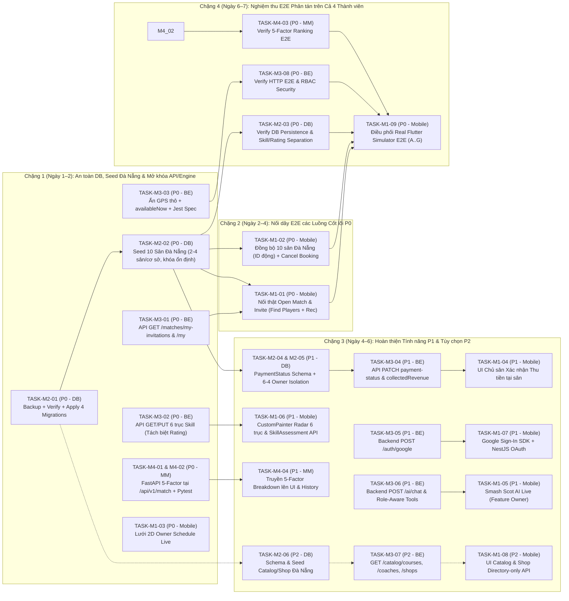

# S-MATCH — FINAL SPRINT EXECUTION BACKLOG (AUDIT V2 — FINAL RECONCILED)

**Ngày lập kế hoạch & chuẩn hóa:** 2026-11-09  
**Nhánh Git cơ sở:** `feature/SMM-41-FinalIntegrationTestingRelease`  
**Chế độ kiểm toán:** STRICT READ-ONLY AUDIT MODE (Chỉ cập nhật tài liệu kiểm toán, không tự ý sửa code/DB)  
**Tài liệu đối chiếu gốc:**  
- [FINAL-SPRINT-REQUIREMENT-MATRIX.md](file:///Users/mbp/Documents/WORKSPACE/Capstone/s-match/docs/audits/FINAL-SPRINT-REQUIREMENT-MATRIX.md)  
- [FINAL-SPRINT-COMPLETION-SCORECARD.md](file:///Users/mbp/Documents/WORKSPACE/Capstone/s-match/docs/audits/FINAL-SPRINT-COMPLETION-SCORECARD.md)

---

## 1. Mô Hình Năng Lực Nhóm, Phân Quyền Trách Nhiệm & Tổng Hợp Task Đã Chuẩn Hóa

### 1.1. Nguyên tắc phân định ranh giới kỹ thuật & Trách nhiệm E2E (Role & E2E Ownership Boundaries)
1. **Member 1 (Mobile Lead):**
   - Phụ trách giao diện Flutter, Riverpod, MapLibre, nối API trên Mobile.
   - Giữ vai trò **Feature Owner của Trợ lý Smash Scot AI** (`REQ-AI-01`).
   - **Điều phối chính kiểm thử Real Flutter Simulator E2E (`TASK-M1-09`)** cho toàn bộ 7 luồng nghiệp vụ (`E2E-FLOW-A..G`) trên máy ảo iOS/Android.
2. **Member 2 (Database & Data Integrity Lead):**
   - Phụ trách Prisma Schema, quy trình an toàn Migration (Backup → Kiểm chứng cô lập → Rollback), và bộ dữ liệu Seed **10 Cơ sở tại Đà Nẵng (2–4 sân/cơ sở = 20–40 sân, dùng khóa tự nhiên ổn định)**.
   - **Phụ trách kiểm chứng Database Persistence & Isolation E2E (`TASK-M2-03`):** Xác minh lưu trữ thực tế, khóa đồng thời `SELECT ... FOR UPDATE`, bất biến tách biệt `Skill` vs `PlayerRating`, và cô lập dữ liệu 6–4 giữa 2 Chủ sân.
3. **Member 3 (Backend Lead):**
   - Phụ trách NestJS REST API, RBAC, Google OAuth (`REQ-AUTH-04`), API Xác nhận thu tiền tại sân (`REQ-FIN-05`), và **xây dựng các công cụ truy vấn dữ liệu phân quyền an toàn (Role-Aware Data Tools) & kết nối LLM API cho Smash Scot** (`REQ-AI-02..04`). *(Không viết lại CRUD Facility/Court vì đã hoàn thiện).*
   - **Phụ trách kiểm chứng Backend API & Security E2E (`TASK-M3-08`):** Xác minh hợp đồng REST, JWT/RBAC guards, ẩn tọa độ GPS thô, trạng thái thanh toán và cô lập quyền AI tools.
4. **Member 4 (Matchmaking & AI Algorithm Lead):**
   - Phụ trách thuật toán xếp hạng **5 yếu tố** (`MatchmakingEngine` tại `POST /api/v1/match`) và môi trường Python FastAPI.
   - **Phụ trách kiểm chứng Matchmaking Ranking E2E (`TASK-M4-03`):** Xác minh độ chính xác công thức 5 yếu tố, tie-breaking tất định, làm mượt Bayesian và pipeline NestJS ↔ FastAPI.

### 1.2. Chính sách Tách biệt Kỹ năng Tự đánh giá, Radar 6 trục và Điểm Uy tín Sau trận (`REQ-PROF-03..04`, `REQ-RATE-01..04`)
- **Tự đánh giá kỹ năng ban đầu & đánh giá lại (`SkillAssessmentScreen` $\rightarrow$ `PUT /players/profile/me/skill`):** Cập nhật trực tiếp bảng `Skill` 6 trục (`smash`, `defense`, `netPlay`, `stamina`, `footwork`, `serve` trên thang `0.0–5.0`).
- **Biểu đồ Radar Kỹ năng 6 trục (`ProfileSkillRadar`):** Chỉ hiển thị trực quan 6 chỉ số kỹ thuật hiện tại từ bảng `Skill` (`GET /players/profile/me`) bằng `CustomPainter`.
- **Đánh giá Uy tín Cộng đồng sau trận (`POST /ratings` $\rightarrow$ `PlayerRating` & `RatingHistory`):** Chỉ cập nhật điểm `communityRating` và `reliabilityScore` (làm mượt Bayesian). **Tuyệt đối không bao giờ tự động làm tăng hay làm thay đổi điểm kỹ thuật trong bảng `Skill` sau một trận đấu.**

### 1.3. Bảng tổng hợp số lượng Task theo Ưu tiên & Thành viên (Reconciled Summary Table)

| Thành viên | Vai trò chính (Role) | Danh sách Task P0 (Critical) | Danh sách Task P1 (Core Functional) | Danh sách Task P2 (Catalog/Shop & OTP) | Số lượng Task (P0 / P1 / P2 / Tổng) | Giờ P0 | Giờ P1 | Tổng tải P0+P1 (Giờ / Ngày) | Giờ P2 *(nếu bật Option A)* |
| :--- | :--- | :--- | :--- | :--- | :---: | :---: | :---: | :---: | :---: |
| **Member 1** | **Mobile Lead** *(Flutter, MapLibre, Smash Scot Owner, Simulator E2E Coordinator)* | `TASK-M1-01` `TASK-M1-02` `TASK-M1-03` `TASK-M1-09` | `TASK-M1-04` `TASK-M1-05` `TASK-M1-06` `TASK-M1-07` | `TASK-M1-08` | **4 P0 / 4 P1 / 1 P2** *(9 Tasks)* | 28 – 38h | 20 – 28h | **48 – 66h** *(~6 – 8 ngày)* | 3 – 4h |
| **Member 2** | **Database & Data Integrity Lead** *(Prisma, Safe Migrations, Da Nang Seed, DB E2E)* | `TASK-M2-01` `TASK-M2-02` `TASK-M2-03` | `TASK-M2-04` `TASK-M2-05` | `TASK-M2-06` | **3 P0 / 2 P1 / 1 P2** *(6 Tasks)* | 14 – 20h | 10 – 14h | **24 – 34h** *(~3.5 – 5 ngày)* | 3 – 4h |
| **Member 3** | **Backend Lead** *(NestJS, Google OAuth, Finance API, Secure AI Tools, Security E2E)* | `TASK-M3-01` `TASK-M3-02` `TASK-M3-03` `TASK-M3-08` | `TASK-M3-04` `TASK-M3-05` `TASK-M3-06` | `TASK-M3-07` `TASK-OPT-02` | **4 P0 / 3 P1 / 2 P2** *(9 Tasks)* | 17 – 25h | 19 – 25h | **36 – 50h** *(~5 – 6.5 ngày)* | 3 – 8h |
| **Member 4** | **Matchmaking Lead** *(FastAPI 5-Factor Engine, Ranking E2E)* | `TASK-M4-01` `TASK-M4-02` `TASK-M4-03` | `TASK-M4-04` | — | **3 P0 / 1 P1 / 0 P2** *(4 Tasks)* | 13 – 18h | 5 – 8h | **18 – 26h** *(~3 – 4 ngày)* | 0h |
| **TỔNG CỘNG** | **Toàn nhóm (4 Thành viên)** | **14 Tasks P0** | **10 Tasks P1** | **4 Tasks P2** | **14 P0 / 10 P1 / 4 P2 (28 Tasks)** | **72 – 101h** | **54 – 75h** | **126 – 176h** | **9 – 16h** *(Option A) hoặc 0h (Option B)* |

---

## 2. Đặc Tả Chi Tiết Từng Công Việc (Complete Task Specifications)

---

### PHẦN A — MEMBER 2: DATABASE & DATA INTEGRITY LEAD

#### `TASK-M2-01` [P0] Thực thi Quy trình An toàn Migration (Backup, Kiểm chứng cô lập, Rollback) & Áp dụng 4 bản Migration đang chờ
- **Mô tả:** Sao lưu cơ sở dữ liệu hiện hành (`pg_dump`), kiểm chứng chuỗi 15 bản migration trên một database tạm cô lập (đặc biệt xác minh bảng `TimeSlot` qua hai migration `20261006024604` và `20261014065156`), chuẩn bị script rollback rồi mới áp dụng 4 bản migration đang chờ (`20261027120000_add_match_feedback`, `20261027120000_smm_36_community_rating`, `20261027130000_smm_36_rating_history`, `20261101120000_smm_40_analytics_indexes`).
- **Source Requirement IDs:** `REQ-OPS-02`, `REQ-RATE-01`, `REQ-RATE-02`, `REQ-RATE-03`, `REQ-FIN-01`
- **Bằng chứng hiện tại:** `npx prisma migrate status` báo 4 migrations chưa được apply trên Docker PostgreSQL (`:5433`); migration `20261006024604` chứa lệnh `DROP TABLE "TimeSlot"` trước khi `20261014065156` tạo lại.
- **Files / Modules tác động:** `backend/prisma/schema.prisma`, `backend/prisma/migrations/*`, `backend/prisma/INTEGRATION_NOTES.md`
- **Owner:** Member 2 (Database Lead)
- **Dependencies:** Không (Task mở đầu đường găng, cần phê duyệt bản backup trước khi chạy).
- **Hợp đồng Schema & Quy trình (Schema & Safety Contract):**
  1. Chạy `pg_dump` lưu bản sao lưu đầy đủ trước khi can thiệp.
  2. Dựng DB tạm (`smatch_migration_verify`), chạy `npx prisma migrate deploy` để xác minh toàn bộ bảng tồn tại đầy đủ và không mất `TimeSlot`.
  3. Chuẩn bị script SQL rollback cho 4 bản migration mới.
- **Tiêu chí nghiệm thu (Acceptance Criteria):**
  1. Có file backup `.sql` và script rollback được kiểm duyệt.
  2. `npx prisma migrate deploy` chạy thành công không mất dữ liệu `Booking` hay `TimeSlot`.
  3. `npx prisma migrate status` trả về `Database schema is up to date!`.
- **Ước lượng nỗ lực:** `4 – 6 giờ` (0.5 – 1 ngày).
- **Kế hoạch kiểm thử & DoD:** Chạy `npx prisma migrate status` và truy vấn kiểm tra cấu trúc các bảng `Feedback`, `PlayerRating`, `RatingHistory`, `TimeSlot`.

---

#### `TASK-M2-02` [P0] Mở rộng `seed.ts` lên chuẩn 10 Cơ sở Cầu lông tại Đà Nẵng (2 Chủ sân 6–4, 2–4 Sân/Cơ sở = 20–40 Sân, Khóa Seed Ổn định, 20+ Người chơi)
- **Mô tả:** Nâng cấp `backend/prisma/seed.ts` để khởi tạo đầy đủ **10 cơ sở cầu lông tại TP. Đà Nẵng** phân bổ cho **2 Chủ sân theo tỷ lệ 6–4**, mỗi cơ sở có **2–4 sân con (tổng cộng 20–40 sân)** kèm `OperatingHours`, `TimeSlot`, và **20+ người chơi tại Đà Nẵng** có đầy đủ hồ sơ kỹ năng 6 trục (`smash`, `defense`, `netPlay`, `stamina`, `footwork`, `serve`). **Sử dụng khóa định danh tự nhiên ổn định (stable unique seed keys) thay vì giả định cứng ID `1..10` trong DB.**
- **Source Requirement IDs:** `REQ-FAC-05`, `REQ-FAC-01`, `REQ-FAC-04`, `REQ-OPS-02`
- **Bằng chứng hiện tại:** [seed.ts](file:///Users/mbp/Documents/WORKSPACE/Capstone/s-match/backend/prisma/seed.ts#L109-L122) hiện chỉ tạo 1 Chủ sân (`owner@smatch.dev`), 1 Cơ sở (gán cứng `id: 1`), 4 Courts và 4 Players; trong khi [demo_catalog.dart](file:///Users/mbp/Documents/WORKSPACE/Capstone/s-match/mobile/lib/features/player_experience/data/demo_catalog.dart#L83-L184) có 10 cơ sở Đà Nẵng mang ID âm (`-1001`..`-1010`).
- **Files / Modules tác động:** `backend/prisma/seed.ts`, `backend/prisma/INTEGRATION_NOTES.md`
- **Owner:** Member 2 (Database Lead)
- **Dependencies:** `TASK-M2-01`
- **Hợp đồng dữ liệu (Data Contract):**
  - **Không giả định cứng ID `1..10`:** Thực hiện tra cứu / upsert idempotent dựa trên khóa tự nhiên ổn định:
    - `User`: upsert theo `email` (`unique`).
    - `Facility`: tìm theo cặp khóa ổn định `(name, ownerId)` (hoặc `name` duy nhất trong tập 10 cơ sở Đà Nẵng) rồi `update` / `create`, lấy `facility.id` thực tế do PostgreSQL cấp để tạo `OperatingHours` và `Court`.
    - `Court`: tìm theo `(facilityId, name)` rồi `update` / `create` **2–4 sân con cho mỗi cơ sở (tổng 20–40 sân toàn hệ thống)**.
    - `TimeSlot`: upsert theo composite unique key `courtId_dayOfWeek_startTime`.
  - **Phân bổ 10 Cơ sở Đà Nẵng (Tỷ lệ 6–4 giữa 2 Chủ sân):**
    - `owner@smatch.dev` (Owner 1 — 6 cơ sở): `Hai Chau Badminton` (`16.061, 108.2165`), `Hoa Cuong Badminton` (`16.034, 108.215`), `Thanh Khe Badminton` (`16.064, 108.185`), `An Khe Badminton` (`16.045, 108.178`), `An Hai Badminton` (`16.065, 108.241`), `Son Tra Badminton` (`16.093, 108.246`).
    - `owner2@smatch.dev` (Owner 2 — 4 cơ sở): `Ngu Hanh Son Badminton` (`16.012, 108.258`), `Hoa Xuan Badminton` (`15.999, 108.220`), `Cam Le Badminton` (`16.012, 108.192`), `Hoa Khanh Badminton` (`16.073, 108.152`).
  - **20+ Người chơi (`PLAYER`):** Upsert theo `email` (`player@smatch.dev`, `player2@smatch.dev` .. `player20@smatch.dev`) quanh Đà Nẵng kèm `PlayerProfile`, `PlayingPreference`, `Availability` và bản ghi `Skill` 6 trục chuẩn (`smash`, `defense`, `netPlay`, `stamina`, `footwork`, `serve`).
- **Tiêu chí nghiệm thu (Acceptance Criteria):**
  1. `npx prisma db seed` chạy idempotent trên mọi trạng thái sequence của DB mà không phụ thuộc vào việc `facility.id` phải bằng `1..10`.
  2. Tổng số cơ sở tại Đà Nẵng là `10` (6 thuộc Owner 1, 4 thuộc Owner 2); mỗi cơ sở có `2–4` sân con (tổng `20–40` sân); tổng số người chơi $\ge 20$.
- **Ước lượng nỗ lực:** `6 – 8 giờ` (1 ngày).
- **Kế hoạch kiểm thử & DoD:** Chạy `npx prisma db seed` 2 lần liên tiếp để xác minh tính idempotent và kiểm tra số lượng bản ghi qua SQL.

---

#### `TASK-M2-03` [P0] Kiểm chứng E2E Tầng Cơ sở Dữ liệu: Lưu trữ, Khóa Đồng thời, Bất biến Kỹ năng vs. Uy tín & Cô lập Chủ sân
- **Mô tả:** Đại diện mảng Database trong chiến dịch E2E toàn nhóm: trực tiếp xác minh tính toàn vẹn dữ liệu trên PostgreSQL cho cả 7 luồng `E2E-FLOW-A..G` (khóa bi quan `SELECT ... FOR UPDATE` khi đặt sân, snapshot `PlayerRating` + `RatingHistory`, lịch sử `RecommendationSession`, cô lập dữ liệu 6–4 giữa 2 Chủ sân, và xác nhận đánh giá sau trận không làm biến đổi bảng `Skill`).
- **Source Requirement IDs:** `REQ-BOOK-03`, `REQ-RATE-01..04`, `REQ-MM-04`, `REQ-FIN-01..02`, `REQ-OPS-02..03`
- **Bằng chứng hiện tại:** Các bảng đánh giá (`PlayerRating`, `RatingHistory`) và lịch sử gợi ý (`RecommendationSession`) chưa được nghiệm thu E2E trên dữ liệu 10 cơ sở Đà Nẵng.
- **Files / Modules tác động:** `backend/prisma/seed.ts`, `backend/src/bookings/bookings.integration.live.spec.ts`, `docs/audits/FINAL-SPRINT-COMPLETION-SCORECARD.md`
- **Owner:** Member 2 (Database Lead)
- **Dependencies:** `TASK-M2-01`, `TASK-M2-02`
- **Tiêu chí nghiệm thu (Acceptance Criteria):**
  1. Xác nhận bằng truy vấn SQL trước và sau khi gửi `POST /ratings`: bảng `PlayerRating` và `RatingHistory` ghi nhận bản ghi mới, `reliabilityScore` cập nhật đúng công thức Bayesian, và **6 cột trong bảng `Skill` giữ nguyên không đổi**.
  2. Xác nhận các truy vấn tổng hợp doanh thu của Owner 1 và Owner 2 trả về đúng tập cơ sở 6–4 tương ứng.
- **Ước lượng nỗ lực:** `4 – 6 giờ` (0.5 – 1 ngày).
- **Kế hoạch kiểm thử & DoD:** Cung cấp bằng chứng SQL query & kết quả test persistence cho biên bản E2E.

---

#### `TASK-M2-04` [P1] Bổ sung `PaymentStatus` vào Prisma Schema & Migration cho Quy trình Thanh toán tại sân
- **Mô tả:** Tách bạch trạng thái đặt sân (`BookingStatus`) và trạng thái thanh toán (`PaymentStatus`) trong bảng `Booking` để phục vụ quy trình Chủ sân xác nhận thu tiền tại sân (`Pay-at-court workflow`) và tính toán doanh thu thực thu (`collectedRevenue`).
- **Source Requirement IDs:** `REQ-FIN-04`, `REQ-FIN-05`, `REQ-FIN-06`
- **Bằng chứng hiện tại:** [schema.prisma](file:///Users/mbp/Documents/WORKSPACE/Capstone/s-match/backend/prisma/schema.prisma#L226-L248) hiện chỉ có `BookingStatus`, chưa có `PaymentStatus`, khiến `RevenueAnalyticsService` trả về `collectedRevenue: null`.
- **Files / Modules tác động:** `backend/prisma/schema.prisma`, `backend/prisma/migrations/*`, `backend/prisma/seed.ts`
- **Owner:** Member 2 (Database Lead)
- **Dependencies:** `TASK-M2-01`
- **Hợp đồng Schema (Schema Contract):**
  - Định nghĩa `enum PaymentStatus { UNPAID PAID PENDING CANCELLED }`.
  - Bổ sung vào model `Booking`: `paymentStatus PaymentStatus @default(UNPAID)` và `paidAt DateTime?`, kèm index `@@index([courtId, paymentStatus, startTime])`.
- **Tiêu chí nghiệm thu (Acceptance Criteria):**
  1. Migration mới (tuân thủ quy trình backup/rollback) chạy an toàn không làm mất dữ liệu `Booking` hiện có.
  2. `seed.ts` tạo sẵn cả đơn `PAID` và `UNPAID` trên 10 cơ sở Đà Nẵng.
- **Ước lượng nỗ lực:** `5 – 7 giờ` (1 ngày).
- **Kế hoạch kiểm thử & DoD:** Kiểm tra schema và chạy test truy vấn tổng tiền theo `paymentStatus = PAID` vs `UNPAID`.

---

#### `TASK-M2-05` [P1] Bổ sung Cờ Đồng thuận Vị trí (`locationSharingConsent`) & Dữ liệu Kiểm thử Cô lập Doanh thu 6–4
- **Mô tả:** Bổ sung trường `locationSharingConsent Boolean @default(false)` vào `PlayerProfile` (phục vụ bảo vệ quyền riêng tư vị trí) và tạo bộ dữ liệu kiểm thử tự động xác nhận cô lập doanh thu giữa Owner 1 (6 cơ sở Đà Nẵng) và Owner 2 (4 cơ sở Đà Nẵng).
- **Source Requirement IDs:** `REQ-MAP-04`, `REQ-FIN-01`, `REQ-FIN-02`
- **Bằng chứng hiện tại:** `PlayerProfile` chưa có cờ đồng thuận vị trí; bộ test live mới kiểm tra trên 1 cơ sở.
- **Files / Modules tác động:** `backend/prisma/schema.prisma`, `backend/src/bookings/bookings.integration.live.spec.ts`
- **Owner:** Member 2 (Database Lead)
- **Dependencies:** `TASK-M2-02`, `TASK-M2-04`
- **Tiêu chí nghiệm thu (Acceptance Criteria):**
  1. Bài test integration xác nhận Owner 1 và Owner 2 chỉ truy cập được đúng 6 và 4 cơ sở Đà Nẵng của mình; truy cập chéo nhận `403 Forbidden`.
- **Ước lượng nỗ lực:** `5 – 7 giờ` (0.5 – 1 ngày).
- **Kế hoạch kiểm thử & DoD:** Pass 100% trong `bookings.integration.live.spec.ts`.

---

#### `TASK-M2-06` [P2] (Phương án A — Nếu tích hợp DB thật cho Catalog/Shop) Thiết kế Schema & Seed Đà Nẵng cho `Course`, `Coach` và `ShopDirectoryEntry`
- **Mô tả:** Nếu nhóm chọn **Phương án A (Tích hợp PostgreSQL/API thật cho M10)** thay vì giữ `DemoCatalog` cục bộ: bổ sung 3 bảng chỉ đọc `Coach`, `Course`, `ShopDirectoryEntry` vào `schema.prisma` và seed dữ liệu tại Đà Nẵng từ `DemoCatalog`. **Bảng `ShopDirectoryEntry` bắt buộc chỉ chứa thông tin danh bạ (`name`, `district`, `address`, `latitude`, `longitude`, `specialty`, `phone`, `email`, `imageKey`), tuyệt đối không có bảng giỏ hàng hay đơn hàng.**
- **Source Requirement IDs:** `REQ-CAT-01`, `REQ-CAT-02`, `REQ-CAT-03`
- **Bằng chứng hiện tại:** Dữ liệu Khóa học, HLV và Cửa hàng hiện nằm trong `mobile/lib/features/player_experience/data/demo_catalog.dart`.
- **Files / Modules tác động:** `backend/prisma/schema.prisma`, `backend/prisma/seed.ts`
- **Owner:** Member 2 (Database Lead)
- **Dependencies:** `TASK-M2-01` (Chỉ thực hiện khi nhóm chọn Phương án A cho M10).
- **Tiêu chí nghiệm thu (Acceptance Criteria):**
  1. Seed đầy đủ 2 Coaches (`Coach Minh`, `Coach Lan`), 3 Courses, 3 Lessons và 3 Shop Directory entries tại Đà Nẵng (`Hai Chau`, `Thanh Khe`, `Son Tra`) bằng khóa `slug` duy nhất.
  2. Không có bất kỳ bảng hay cột nào liên quan đến giỏ hàng, đặt hàng hoặc thanh toán sản phẩm.
- **Ước lượng nỗ lực:** `3 – 4 giờ` (0.5 ngày).
- **Kế hoạch kiểm thử & DoD:** Chạy `npx prisma db seed` và kiểm tra dữ liệu bảng `Coach`, `Course`, `ShopDirectoryEntry`.

---

### PHẦN B — MEMBER 3: BACKEND LEAD

#### `TASK-M3-01` [P0] Bổ sung Endpoint Danh sách Lời mời & Trận đấu của tôi (`GET /matches/my-invitations` & `GET /matches/my`)
- **Mô tả:** Bổ sung các endpoint còn thiếu trong `MatchesController` để người chơi lấy danh sách lời mời tham gia trận đấu (`INVITED`, bao gồm cả trận `PRIVATE`) và danh sách các trận mình làm Host/Member kèm yêu cầu xin vào (`REQUESTED`).
- **Source Requirement IDs:** `REQ-MATCH-01`, `REQ-MATCH-02`, `REQ-MATCH-03`, `REQ-MATCH-04`, `REQ-MATCH-05`
- **Bằng chứng hiện tại:** [matches.controller.ts](file:///Users/mbp/Documents/WORKSPACE/Capstone/s-match/backend/src/matches/matches.controller.ts) đã có `POST /matches`, `GET /matches/open`, `POST /matches/:id/invite`, `POST /matches/:id/join-request`, `PATCH /matches/:id/invitations/accept|reject`, `PATCH /matches/:id/requests/:userId/approve|reject`, nhưng thiếu endpoint lấy danh sách lời mời của user đang đăng nhập.
- **Files / Modules tác động:** `backend/src/matches/matches.controller.ts`, `backend/src/matches/matches.service.ts`, `backend/src/matches/matches.lifecycle.spec.ts`
- **Owner:** Member 3 (Backend Lead)
- **Dependencies:** Không.
- **Hợp đồng API (API Contract):**
  - `GET /matches/my-invitations`: Yêu cầu JWT, trả về các bản ghi `MatchParticipant` của `req.user.sub` có `status = INVITED` kèm thông tin `match` và `host`.
  - `GET /matches/my`: Trả về các trận do `req.user.sub` làm `HOST` (kèm danh sách `participants` đang `REQUESTED`, `INVITED`, `ACCEPTED`) hoặc đã tham gia (`ACCEPTED`).
- **Tiêu chí nghiệm thu (Acceptance Criteria):**
  1. Người chơi được mời vào trận `PRIVATE` hoặc `OPEN` gọi `GET /matches/my-invitations` thấy đầy đủ lời mời để bấm Accept/Reject.
  2. Host gọi `GET /matches/my` thấy danh sách người chơi đang `REQUESTED` để bấm Approve/Reject.
- **Ước lượng nỗ lực:** `5 – 7 giờ` (1 ngày).
- **Kế hoạch kiểm thử & DoD:** Bổ sung unit test trong `matches.lifecycle.spec.ts` đạt 100% PASS.

---

#### `TASK-M3-02` [P0] Đồng bộ API Kỹ năng 6 trục (`GET /players/profile/me` kèm `skill` & `PUT /players/profile/me/skill`) & Đảm bảo Bất biến Tách biệt với Đánh giá Sau trận
- **Mô tả:** Sửa `PlayersService.getMyProfile` để trả kèm quan hệ `skill` và bổ sung endpoint `PUT /players/profile/me/skill` cho phép lưu đúng 6 trục kỹ năng kỹ thuật trong Prisma schema (`smash`, `defense`, `netPlay`, `stamina`, `footwork`, `serve`) từ màn hình tự đánh giá (`SkillAssessmentScreen`). Đảm bảo `RatingsService` và `MatchesService` không bao giờ tự động ghi đè hay cộng điểm vào bảng `Skill` sau trận đấu.
- **Source Requirement IDs:** `REQ-PROF-03`, `REQ-PROF-04`, `REQ-RATE-04`
- **Bằng chứng hiện tại:** [schema.prisma](file:///Users/mbp/Documents/WORKSPACE/Capstone/s-match/backend/prisma/schema.prisma#L108-L120) định nghĩa bảng `Skill` gồm 6 trường `smash`, `defense`, `netPlay`, `stamina`, `footwork`, `serve`; nhưng `PlayersService.getMyProfile` chưa `include: { skill: true }` và chưa có endpoint cập nhật bảng `Skill`.
- **Files / Modules tác động:** `backend/src/players/players.controller.ts`, `backend/src/players/players.service.ts`, `backend/src/players/dto/update-skill.dto.ts` (mới)
- **Owner:** Member 3 (Backend Lead)
- **Dependencies:** Không.
- **Hợp đồng API & Chính sách Nghiệp vụ (API & Policy Contract):**
  - `GET /players/profile/me`: Trả thêm đối tượng `skill: { smash, defense, netPlay, stamina, footwork, serve }`.
  - `PUT /players/profile/me/skill`: Nhận DTO gồm đúng 6 trường số thực (`@Min(0) @Max(5)`): `smash`, `defense`, `netPlay`, `stamina`, `footwork`, `serve`; thực hiện `prisma.skill.upsert` theo `playerProfileId` và cập nhật nhãn `skillLevel` (`BEGINNER` / `INTERMEDIATE` / `ADVANCED`) theo điểm trung bình.
  - **Quy tắc bất biến:** Chỉ `PUT /players/profile/me/skill` mới được phép cập nhật bảng `Skill`; `POST /ratings` chỉ cập nhật `PlayerRating`, `RatingHistory` và `reliabilityScore`.
- **Tiêu chí nghiệm thu (Acceptance Criteria):**
  1. `PUT /players/profile/me/skill` lưu chính xác 6 trục vào bảng `Skill` trong PostgreSQL.
  2. `GET /players/profile/me` trả về đúng 6 chỉ số vừa lưu, và `CandidatesService` đọc được ngay khi ghép trận.
- **Ước lượng nỗ lực:** `4 – 6 giờ` (0.5 – 1 ngày).
- **Kế hoạch kiểm thử & DoD:** Viết unit test cho `getMyProfile` và `updateMySkill` trong `players.service.spec.ts`.

---

#### `TASK-M3-03` [P0] Bảo mật Tọa độ trong `GET /candidates/nearby`, Bổ sung `availableNow` & Viết Unit Test cho `facilities.service.spec.ts`
- **Mô tả:** Loại bỏ tọa độ GPS chính xác (`latitude`, `longitude`) của người chơi khác khỏi response của `GET /candidates/nearby` (chỉ trả `distanceKm`), bổ sung trường boolean `availableNow` dựa trên lịch rảnh hiện tại, và viết đầy đủ unit test cho file rỗng `backend/src/facilities/facilities.service.spec.ts`.
- **Source Requirement IDs:** `REQ-MAP-04`, `REQ-MAP-05`, `REQ-OPS-03`, `REQ-OPS-04`
- **Bằng chứng hiện tại:** [candidates.service.ts](file:///Users/mbp/Documents/WORKSPACE/Capstone/s-match/backend/src/candidates/candidates.service.ts#L109-L117) đang trả trực tiếp `latitude` và `longitude` của ứng viên trong `findNearby`; `facilities.service.spec.ts` rỗng `0 byte`.
- **Files / Modules tác động:** `backend/src/candidates/candidates.service.ts`, `backend/src/candidates/candidates.service.spec.ts`, `backend/src/facilities/facilities.service.spec.ts`
- **Owner:** Member 3 (Backend Lead)
- **Dependencies:** Không.
- **Hợp đồng API (API Contract):**
  - Response của `GET /candidates/nearby`: Mỗi phần tử trong `candidates[]` trả về `{ userId, fullName, nickname, skillLevel, distanceKm, availableNow, playingStyle }` — **ẩn `latitude` và `longitude` thô**.
- **Tiêu chí nghiệm thu (Acceptance Criteria):**
  1. `GET /candidates/nearby` không làm lộ tọa độ GPS chính xác của người chơi khác và trả về `availableNow: true/false`.
  2. `facilities.service.spec.ts` kiểm thử đầy đủ CRUD trong `FacilitiesService`; toàn bộ unit test Jest trong `backend/src` đạt 100% PASS.
- **Ước lượng nỗ lực:** `4 – 6 giờ` (0.5 – 1 ngày).
- **Kế hoạch kiểm thử & DoD:** Chạy `npx jest src/candidates/candidates.service.spec.ts src/facilities/facilities.service.spec.ts` đạt PASS 100%.

---

#### `TASK-M3-08` [P0] Kiểm chứng E2E Tầng Backend API, Bảo mật Phân quyền (RBAC) & Hợp đồng Dịch vụ
- **Mô tả:** Đại diện mảng Backend trong chiến dịch E2E toàn nhóm: thực thi và xác minh toàn bộ bộ kiểm thử HTTP/API E2E (`bookings.integration.live.spec.ts`, `matches.http.spec.ts`, `ratings.http.spec.ts`, `users.http.spec.ts`) trên môi trường dịch vụ thật, kiểm chứng bảo mật RBAC, xoay vòng Refresh Token, ẩn tọa độ GPS, xác nhận thanh toán và cô lập quyền của AI Tools.
- **Source Requirement IDs:** `REQ-AUTH-01..03`, `REQ-FAC-01..04`, `REQ-BOOK-01..05`, `REQ-MATCH-01..06`, `REQ-OPS-03..04`
- **Bằng chứng hiện tại:** 8 file `.http.spec.ts` chưa chạy được trong macOS Sandbox do hạn chế bind cổng loopback; cần chạy trực tiếp trên máy phát triển kết nối Docker PostgreSQL sau khi hoàn tất migration.
- **Files / Modules tác động:** `backend/src/**/*.http.spec.ts`, `backend/src/bookings/bookings.integration.live.spec.ts`
- **Owner:** Member 3 (Backend Lead)
- **Dependencies:** `TASK-M2-01..02`, `TASK-M3-01..03`
- **Tiêu chí nghiệm thu (Acceptance Criteria):**
  1. Toàn bộ 27/27 bộ Jest test (19 unit test suites + 8 HTTP/live integration test suites) đạt 100% PASS.
  2. Xác minh các trường hợp âm tính (401 khi token revoke, 403 khi Owner A truy cập cơ sở của Owner B, 409 khi đặt sân trùng giờ).
- **Ước lượng nỗ lực:** `4 – 6 giờ` (0.5 – 1 ngày).
- **Kế hoạch kiểm thử & DoD:** Đính kèm log kết quả 27/27 Jest suites PASS vào báo cáo nghiệm thu.

---

#### `TASK-M3-04` [P1] Triển khai API Xác nhận Thu tiền tại sân (`PATCH /bookings/:id/payment-status`) & Tính toán `collectedRevenue` / `outstandingRevenue`
- **Mô tả:** Cung cấp API để Chủ sân (hoặc Admin) xác nhận đã thu tiền đơn đặt sân tại sân (`PAID` / `UNPAID` / `CANCELLED`), đồng thời cập nhật `RevenueAnalyticsService` để tính toán chính xác Doanh thu thực thu (`collectedRevenue`) và Công nợ chưa thu (`outstandingRevenue`).
- **Source Requirement IDs:** `REQ-FIN-04`, `REQ-FIN-05`, `REQ-FIN-06`
- **Bằng chứng hiện tại:** [revenue-analytics.service.ts](file:///Users/mbp/Documents/WORKSPACE/Capstone/s-match/backend/src/analytics/revenue-analytics.service.ts#L88-L90) hiện chỉ tính `grossBookedRevenue` và gán `collectedRevenue: null`.
- **Files / Modules tác động:** `backend/src/bookings/bookings.controller.ts`, `backend/src/bookings/bookings.service.ts`, `backend/src/bookings/dto/update-payment-status.dto.ts` (mới), `backend/src/analytics/revenue-analytics.service.ts`, `backend/src/analytics/revenue-analytics.service.spec.ts`
- **Owner:** Member 3 (Backend Lead)
- **Dependencies:** `TASK-M2-04` (`PaymentStatus` trong Prisma schema)
- **Hợp đồng API (API Contract):**
  - `PATCH /bookings/:id/payment-status`: Chỉ cho phép `COURT_OWNER` sở hữu cơ sở chứa sân của đơn đặt đó (hoặc `ADMIN`) cập nhật `{ paymentStatus: 'PAID' | 'UNPAID' | 'PENDING' | 'CANCELLED' }`, tự động ghi nhận `paidAt`.
  - `GET /analytics/revenue/overview`: Trả về `{ grossBookedRevenue, collectedRevenue, outstandingRevenue }`.
- **Tiêu chí nghiệm thu (Acceptance Criteria):**
  1. Chủ sân A không thể xác nhận thanh toán cho đơn đặt sân thuộc cơ sở của Chủ sân B (`403 Forbidden`).
  2. Khi chuyển đơn sang `PAID`, `collectedRevenue` tăng đúng bằng `totalPrice` và `outstandingRevenue` giảm tương ứng.
- **Ước lượng nỗ lực:** `6 – 8 giờ` (1 ngày).
- **Kế hoạch kiểm thử & DoD:** Cập nhật `revenue-analytics.service.spec.ts` và `bookings.service.spec.ts` đạt 100% PASS.

---

#### `TASK-M3-05` [P1] Triển khai Xác thực Google OAuth tại Backend (`POST /auth/google`)
- **Mô tả:** Xây dựng endpoint `POST /auth/google` trong `AuthController` để xác thực Google ID Token từ Flutter, tự động tìm hoặc tạo mới `User` (role `PLAYER`) + `PlayerProfile` trong PostgreSQL, lưu `RefreshSession` và trả về cặp JWT Access/Refresh token chuẩn của S-Match.
- **Source Requirement IDs:** `REQ-AUTH-04`
- **Bằng chứng hiện tại:** `AuthController` mới có `/auth/register`, `/auth/login`, `/auth/refresh`, `/auth/logout`; chưa có `/auth/google`.
- **Files / Modules tác động:** `backend/src/auth/auth.controller.ts`, `backend/src/auth/auth.service.ts`, `backend/src/auth/dto/google-login.dto.ts` (mới)
- **Owner:** Member 3 (Backend Lead)
- **Dependencies:** Không.
- **Hợp đồng API (API Contract):**
  - `POST /auth/google`: Nhận `{ idToken: string }`, xác minh chữ ký và `aud`/`email_verified` của Google token, upsert `User` theo `email`, tạo `RefreshSession` và trả về `{ access_token, refresh_token, user: { id, email, fullName, role } }`.
- **Tiêu chí nghiệm thu (Acceptance Criteria):**
  1. Token Google hợp lệ đăng nhập thành công và dùng được `access_token` cho mọi API có `@UseGuards(JwtAuthGuard)`.
  2. Token giả mạo hoặc hết hạn bị từ chối với `401 Unauthorized`.
- **Ước lượng nỗ lực:** `5 – 7 giờ` (0.5 – 1 ngày).
- **Kế hoạch kiểm thử & DoD:** Viết unit test với mock Google verifier trong `auth.service.spec.ts`.

---

#### `TASK-M3-06` [P1] Xây dựng Module Backend `POST /ai/chat` & Công cụ Truy vấn Dữ liệu Phân quyền (Role-Aware AI Tools) cho Smash Scot
- **Mô tả:** Tạo module `backend/src/ai/` cung cấp endpoint `POST /ai/chat` (yêu cầu JWT), kết nối LLM API kèm hệ thống Function/Tool Calling truy vấn dữ liệu thực tế từ PostgreSQL theo đúng vai trò (`PLAYER`, `COURT_OWNER`, `ADMIN`) và chống bịa đặt dữ liệu (hallucination prevention).
- **Source Requirement IDs:** `REQ-AI-02`, `REQ-AI-03`, `REQ-AI-04`
- **Bằng chứng hiện tại:** Backend chưa có module `src/ai/`; các service dữ liệu nền (`TimeSlotsService`, `CandidatesService`, `MatchesService`, `RevenueAnalyticsService`, `BookingsService`) đã có sẵn.
- **Files / Modules tác động:** `backend/src/ai/ai.module.ts`, `backend/src/ai/ai.controller.ts`, `backend/src/ai/ai.service.ts`, `backend/src/ai/ai-tools.service.ts` (mới)
- **Owner:** Member 3 (Backend Lead)
- **Dependencies:** `TASK-M2-02`
- **Hợp đồng API & Bảo mật (API & RBAC Contract):**
  - `POST /ai/chat`: Nhận `{ message: string, conversationHistory?: [...] }`, đọc `userId` và `role` từ JWT (`req.user`).
  - **Tools cho `PLAYER` (`REQ-AI-03`):** `searchAvailableCourts(date, district)`, `findNearbyPlayers(radiusKm)`, `listOpenMatches()`, `listShopsAndCourses()`.
  - **Tools cho `COURT_OWNER` (`REQ-AI-04`):** `getMyFacilityRevenue(range)` và `getMyFacilityBookings(date, facilityId)` — **bắt buộc truyền `ownerId = req.user.sub`**, tuyệt đối không cho phép truy vấn cơ sở của Chủ sân khác.
  - **Tools cho `ADMIN` (`REQ-AI-04`):** `getSystemAnalyticsOverview(range)`.
- **Tiêu chí nghiệm thu (Acceptance Criteria):**
  1. `PLAYER` hỏi sân trống tại Đà Nẵng nhận được đúng danh sách sân và giá từ DB; nếu hỏi doanh thu của Chủ sân sẽ bị từ chối quyền.
  2. `COURT_OWNER` 1 hỏi doanh thu chỉ nhận được số liệu của 6 cơ sở mình quản lý, không thể truy cập 4 cơ sở của `COURT_OWNER` 2.
- **Ước lượng nỗ lực:** `8 – 10 giờ` (1 – 1.5 ngày).
- **Kế hoạch kiểm thử & DoD:** Viết unit test kiểm tra cô lập RBAC của `AiToolsService` cho cả 3 roles (`PLAYER`, `COURT_OWNER`, `ADMIN`).

---

#### `TASK-M3-07` [P2] (Phương án A — Nếu tích hợp API thật cho Catalog/Shop) Xây dựng Read-Only Endpoints `GET /catalog/courses`, `/coaches`, `/shops`
- **Mô tả:** Nếu nhóm chọn **Phương án A cho M10**: tạo `CatalogController` và `CatalogService` cung cấp các endpoint chỉ đọc trả về danh sách Khóa học, HLV và Danh bạ Cửa hàng tại Đà Nẵng từ PostgreSQL. **Giữ nguyên phạm vi Shop là Directory-only (không có API giỏ hàng, đặt hàng hay thanh toán).**
- **Source Requirement IDs:** `REQ-CAT-01`, `REQ-CAT-02`, `REQ-CAT-03`, `REQ-CAT-04`
- **Bằng chứng hiện tại:** Chưa có module `backend/src/catalog/`.
- **Files / Modules tác động:** `backend/src/catalog/catalog.module.ts`, `catalog.controller.ts`, `catalog.service.ts` (mới)
- **Owner:** Member 3 (Backend Lead)
- **Dependencies:** `TASK-M2-06` (Chỉ thực hiện khi nhóm chọn Phương án A cho M10).
- **Hợp đồng API (API Contract):**
  - `GET /catalog/courses`, `GET /catalog/coaches`, `GET /catalog/shops?district=&q=`: Trả về danh mục chỉ đọc từ PostgreSQL.
- **Tiêu chí nghiệm thu (Acceptance Criteria):**
  1. Các endpoint trả về đúng dữ liệu Đà Nẵng từ DB và hỗ trợ tìm kiếm theo từ khóa.
  2. Tuyệt đối không có bất kỳ endpoint cart/order/checkout nào.
- **Ước lượng nỗ lực:** `3 – 4 giờ` (0.5 ngày).
- **Kế hoạch kiểm thử & DoD:** Unit test cho `CatalogService` đạt 100% PASS.

---

#### `TASK-OPT-02` [P2] Kiểm soát Phạm vi Đăng nhập SMS OTP (`REQ-AUTH-05`) & Khôi phục Mật khẩu Email OTP (`REQ-AUTH-06`)
- **Mô tả:** Giữ nguyên trạng thái UI Preview có thông báo minh bạch cho SMS OTP (do không dùng cổng SMS trả phí), hoặc bổ sung API đặt lại mật khẩu qua mã OTP lưu trong bảng tạm trên DB phục vụ demo nội bộ nếu nhóm yêu cầu.
- **Source Requirement IDs:** `REQ-AUTH-05`, `REQ-AUTH-06`
- **Bằng chứng hiện tại:** `login_screen.dart:190-194` báo SnackBar SMS login cho bản phát hành tương lai; `forgot_password_screen.dart` dùng mã thử nghiệm `2846`.
- **Files / Modules tác động:** `mobile/lib/features/auth/screens/forgot_password_screen.dart`, `login_screen.dart`
- **Owner:** Member 3 (Backend Lead) + Member 1 (Mobile Lead)
- **Dependencies:** Sau khi hoàn tất P0 & P1.
- **Tiêu chí nghiệm thu (Acceptance Criteria):**
  1. Luồng đăng nhập chính (`Email/Password` + `Google Sign-In`) hoạt động 100% với Backend thật; các nút thuộc phạm vi Optional có thông báo rõ ràng.
- **Ước lượng nỗ lực:** `0 – 4 giờ` (Tùy chọn).
- **Kế hoạch kiểm thử & DoD:** Kiểm tra widget test màn hình Auth.

---

### PHẦN C — MEMBER 1: MOBILE LEAD (Kiêm Smash Scot AI Feature Owner & Simulator E2E Coordinator)

#### `TASK-M1-01` [P0] Nối thật toàn bộ luồng Open Match, Xin vào trận & Lời mời Người chơi từ cả Find Players Map và Recommendations
- **Mô tả:** Thay thế `MatchUiStore` (RAM cục bộ) ở chế độ Live bằng các lời gọi REST API thật tới Backend cho toàn bộ màn hình Match; đồng thời mở khóa chức năng **Mời người chơi trực tiếp (`POST /matches/:id/invite`)** trên `RecommendedPlayerDetailScreen` khi đi từ cả **Find Players trên Bản đồ (`FindPlayersMapScreen`)** lẫn **Danh sách Gợi ý (`RecommendationListScreen`)**.
- **Source Requirement IDs:** `REQ-MATCH-01`, `REQ-MATCH-02`, `REQ-MATCH-03`, `REQ-MATCH-04`, `REQ-MATCH-05`, `REQ-MM-04`
- **Bằng chứng hiện tại:**
  1. `CreateMatchScreen:796`, `MatchListScreen`, `MatchDetailOpenScreen`, `MatchJoinRequestsScreen`, `MatchInvitationsScreen`, `MatchParticipantListScreen` chỉ gọi `MatchUiStore.instance`.
  2. [recommended_player_detail_screen.dart](file:///Users/mbp/Documents/WORKSPACE/Capstone/s-match/mobile/lib/features/recommendation/screens/recommended_player_detail_screen.dart#L15-L42) (được mở từ cả [find_players_map_screen.dart](file:///Users/mbp/Documents/WORKSPACE/Capstone/s-match/mobile/lib/features/court_map/screens/find_players_map_screen.dart#L144-L171) và `RecommendationListScreen`) hiện hộp thoại báo chưa hỗ trợ mời trực tiếp.
- **Files / Modules tác động:** `mobile/lib/features/match/data/match_api_service.dart` (mới), `create_match_screen.dart`, `match_list_screen.dart`, `match_detail_open_screen.dart`, `match_join_requests_screen.dart`, `match_invitations_screen.dart`, `match_participant_list_screen.dart`, `recommended_player_detail_screen.dart`
- **Owner:** Member 1 (Mobile Lead)
- **Dependencies:** `TASK-M3-01` (`GET /matches/my-invitations` & `GET /matches/my`)
- **Hợp đồng tích hợp (Integration Contract):**
  - Tạo trận: Gọi `POST /matches` (hoặc `POST /bookings/:bookingId/open-match`).
  - Xem danh sách & chi tiết: Gọi `GET /matches/open` và `GET /matches/:id`.
  - Xin vào trận & Duyệt/Từ chối: Gọi `POST /matches/:id/join-request` và `PATCH /matches/:id/requests/:userId/approve|reject`.
  - **Mời người chơi từ `FindPlayersMapScreen` & `RecommendationListScreen`:** Khi bấm *Invite to Match* trên `RecommendedPlayerDetailScreen`, hiển thị bottom sheet chọn 1 trận đang mở của Host (từ `GET /matches/my`) hoặc tạo trận mới, sau đó gọi `POST /matches/:id/invite` (và cập nhật `RecommendationOutcome = INVITED` nếu đi từ gợi ý).
  - Xem & Phản hồi lời mời: `MatchInvitationsScreen` gọi `GET /matches/my-invitations` và `PATCH /matches/:id/invitations/accept|reject`.
- **Tiêu chí nghiệm thu (Acceptance Criteria):**
  1. Host tạo Open Match trên Mobile → lưu vào PostgreSQL → tài khoản khác thấy ngay trong `MatchListScreen`.
  2. Người chơi khác bấm Join → Host duyệt/từ chối trên `MatchJoinRequestsScreen` cập nhật trạng thái thật trong DB.
  3. Từ cả bản đồ `FindPlayersMapScreen` lẫn `RecommendationListScreen`, Host mở hồ sơ người chơi bấm Invite → người được mời thấy lời mời trong `MatchInvitationsScreen` và bấm Accept/Reject thành công.
- **Ước lượng nỗ lực:** `12 – 16 giờ` (1.5 – 2 ngày).
- **Kế hoạch kiểm thử & DoD:** Cập nhật `match_screens_test.dart`, `recommendation_flow_test.dart` và chạy kiểm thử 2 tài khoản trên Simulator.

---

#### `TASK-M1-02` [P0] Đồng bộ 10 Cơ sở Đà Nẵng giữa Home/Explore/Search và Map (`GET /facilities` với ID động), Nối nút Hủy Đặt sân & Cập nhật Vị trí
- **Mô tả:** Chuyển `PlayerHomeScreen`, `ExploreCourtsScreen` và `ExperienceSearchScreen` ở chế độ Live sang đọc danh sách 10 cơ sở cầu lông Đà Nẵng từ `GET /facilities` (sử dụng trực tiếp `facility.id` dương động do Backend trả về, không giả định cứng ID `1..10`) thay vì `DemoCatalog` (ID âm `-1001..1010`); nối nút Cancel trên `BookingDetailScreen` gọi `PATCH /bookings/:id/cancel`; và bổ sung lệnh gọi `PATCH /candidates/me/location` khi người chơi cập nhật vị trí trên bản đồ.
- **Source Requirement IDs:** `REQ-FAC-05`, `REQ-BOOK-05`, `REQ-PROF-05`, `REQ-CAT-04`
- **Bằng chứng hiện tại:**
  1. `PlayerHomeScreen` và `ExploreCourtsScreen` đọc `DemoCatalog.facilities` (ID âm), nên khi bấm vào sân từ màn Home sẽ bị coi là sân demo không đặt thật được.
  2. [booking_detail_screen.dart](file:///Users/mbp/Documents/WORKSPACE/Capstone/s-match/mobile/lib/features/booking/screens/booking_detail_screen.dart#L204-L221) chưa gọi `PATCH /bookings/:id/cancel` ở chế độ Live.
  3. Mobile chưa gọi `PATCH /candidates/me/location`.
- **Files / Modules tác động:** `mobile/lib/features/player_experience/screens/player_home_screen.dart`, `courts_screens.dart`, `mobile/lib/features/booking/screens/booking_detail_screen.dart`, `live_booking_service.dart`, `mobile/lib/features/court_map/screens/find_players_map_screen.dart`
- **Owner:** Member 1 (Mobile Lead)
- **Dependencies:** `TASK-M2-02` (Seed 10 cơ sở Đà Nẵng vào DB)
- **Tiêu chí nghiệm thu (Acceptance Criteria):**
  1. Màn hình Home, Explore Courts, Search và Map đều hiển thị cùng 10 cơ sở Đà Nẵng từ `GET /facilities` (với `facility.id > 0` thực tế từ DB), bấm từ Home vào đặt sân lưu PostgreSQL thành công.
  2. Bấm Cancel trên `BookingDetailScreen` ở chế độ Live gọi `PATCH /bookings/:id/cancel`, chuyển trạng thái sang `CANCELLED` và giải phóng slot ngay lập tức.
  3. Người chơi cập nhật tọa độ Đà Nẵng hiện tại của mình qua `PATCH /candidates/me/location`.
- **Ước lượng nỗ lực:** `6 – 8 giờ` (1 ngày).
- **Kế hoạch kiểm thử & DoD:** Bổ sung test hủy đơn trong `live_booking_test.dart` và test đồng bộ danh sách sân trong `sprint10_experience_test.dart`.

---

#### `TASK-M1-03` [P0] Dựng Lưới lịch 2D (`DashboardScheduleGrid`) cho Tab Schedule của Chủ sân ở chế độ Live API
- **Mô tả:** Chuyển đổi danh sách đơn đặt sân thật từ `GET /bookings/owner` và danh sách sân con của cơ sở đang chọn thành ma trận 2 chiều (Sân $\times$ Khung giờ) bằng widget `DashboardScheduleGrid` trong tab Schedule của Chủ sân ở chế độ Live (`!data.preview`).
- **Source Requirement IDs:** `REQ-FIN-03`
- **Bằng chứng hiện tại:** [dashboard_screen.dart](file:///Users/mbp/Documents/WORKSPACE/Capstone/s-match/mobile/lib/features/dashboard/screens/dashboard_screen.dart#L1383-L1400) ở chế độ `preview: true` hiển thị `DashboardScheduleGrid`, nhưng ở chế độ Live (`!data.preview`) chỉ hiển thị danh sách dọc `_bookingCard(b)`.
- **Files / Modules tác động:** `mobile/lib/features/dashboard/data/dashboard_repository.dart`, `dashboard_screen.dart`, `dashboard_widgets.dart`
- **Owner:** Member 1 (Mobile Lead)
- **Dependencies:** Không (`GET /bookings/owner` và `GET /facilities/my` đã hoạt động).
- **Tiêu chí nghiệm thu (Acceptance Criteria):**
  1. Ở chế độ Live, khi Chủ sân chọn tab Schedule và chọn ngày/cơ sở, màn hình hiển thị cả lưới 2D `DashboardScheduleGrid` (phân biệt màu theo trạng thái đơn đặt) lẫn danh sách thẻ chi tiết bên dưới.
- **Ước lượng nỗ lực:** `6 – 8 giờ` (1 ngày).
- **Kế hoạch kiểm thử & DoD:** Cập nhật `dashboard_flow_test.dart` kiểm tra sự hiện diện của `DashboardScheduleGrid` ở chế độ `preview: false`.

---

#### `TASK-M1-09` [P0] Điều phối & Thực thi Kiểm thử Tương tác Real Flutter Simulator E2E (7 Luồng `E2E-FLOW-A..G`)
- **Mô tả:** Với vai trò **Điều phối viên Simulator E2E**, Mobile Lead khởi chạy ứng dụng Flutter trên iOS Simulator / Android Emulator kết nối trực tiếp vào NestJS (`:3000`) + FastAPI (`:8000`) + PostgreSQL (`:5433`), thực hiện kiểm thử tương tác đầu-cuối cho cả 7 luồng nghiệp vụ (`E2E-FLOW-A..G`) trên dữ liệu Đà Nẵng, phối hợp cùng Member 2 (kiểm tra DB), Member 3 (kiểm tra log API/RBAC) và Member 4 (kiểm tra kết quả xếp hạng Matchmaking).
- **Source Requirement IDs:** Chiều `F (Real E2E)` của toàn bộ các yêu cầu trên Mobile (`M01`–`M12`)
- **Bằng chứng hiện tại:** Nhiều luồng đã pass API/DB integration test (`F = 0.5`) nhưng chưa được chạy tương tác trực tiếp trên Flutter Simulator nối toàn bộ dịch vụ thật.
- **Files / Modules tác động:** `docs/audits/FINAL-SPRINT-COMPLETION-SCORECARD.md` (cập nhật cột Kết quả Flutter Simulator E2E)
- **Owner:** Member 1 (Mobile Lead — **Simulator E2E Coordinator**)
- **Dependencies:** `TASK-M1-01..03`, `TASK-M2-01..03`, `TASK-M3-01..03`, `TASK-M4-01..02`
- **Tiêu chí nghiệm thu (Acceptance Criteria):**
  1. Cả 7 luồng `E2E-FLOW-A..G` được thực thi trực tiếp trên Simulator không lỗi UI, không fallback nhầm về mock data, và cập nhật đúng dữ liệu trên PostgreSQL.
  2. Ghi nhận đầy đủ bằng chứng (ảnh chụp màn hình / log) vào bảng E2E Scorecard.
- **Ước lượng nỗ lực:** `4 – 6 giờ` (0.5 – 1 ngày).
- **Kế hoạch kiểm thử & DoD:** Toàn bộ 7 luồng trong bảng E2E chuyển trạng thái cột Simulator E2E sang `PASS`.

---

#### `TASK-M1-04` [P1] Giao diện Chủ sân Xác nhận Thu tiền tại sân (Pay-at-Court) & Hiển thị Doanh thu Thực thu (`collectedRevenue`)
- **Mô tả:** Bổ sung nút xác nhận đã thu tiền (`Mark as Paid` / `PaymentStatus`) trên màn hình chi tiết đơn đặt sân của Chủ sân (`OwnerBookingDetailScreen` / `DashboardScreen`), gọi `PATCH /bookings/:id/payment-status`, và hiển thị rõ 3 chỉ số tài chính: Doanh thu đặt sân (`grossBookedRevenue`), Doanh thu thực thu (`collectedRevenue`), và Công nợ chưa thu (`outstandingRevenue`).
- **Source Requirement IDs:** `REQ-FIN-04`, `REQ-FIN-05`, `REQ-FIN-06`
- **Bằng chứng hiện tại:** `OwnerBookingDetailScreen` trong `dashboard_widgets.dart` và `DashboardRepository` chưa có trường `paymentStatus` và nút bấm gọi API xác nhận thu tiền.
- **Files / Modules tác động:** `mobile/lib/features/dashboard/data/dashboard_repository.dart`, `dashboard_screen.dart`, `dashboard_widgets.dart`
- **Owner:** Member 1 (Mobile Lead)
- **Dependencies:** `TASK-M2-04`, `TASK-M3-04`
- **Tiêu chí nghiệm thu (Acceptance Criteria):**
  1. Chủ sân bấm xác nhận thu tiền trên đơn đặt sân → gọi `PATCH /bookings/:id/payment-status` với `PAID` → huy hiệu đổi sang `PAID` và số liệu `collectedRevenue` trên Dashboard tăng lên ngay khi refresh.
- **Ước lượng nỗ lực:** `6 – 8 giờ` (1 ngày).
- **Kế hoạch kiểm thử & DoD:** Bổ sung widget test xác nhận thanh toán trong `dashboard_flow_test.dart`.

---

#### `TASK-M1-05` [P1] (Feature Owner — Smash Scot AI) Tích hợp Trợ lý Smash Scot AI với Backend `POST /ai/chat` theo Phân quyền Vai trò
- **Mô tả:** Với vai trò **Feature Owner của Smash Scot AI**, Mobile Lead nâng cấp widget `SmashScot` từ hàm `_reply()` tĩnh sang gọi `POST /ai/chat` trên Backend, hiển thị trạng thái đang suy nghĩ (loading), render danh sách trích dẫn dữ liệu thật (`citations` / gợi ý sân & đối thủ tại Đà Nẵng), và tích hợp nút nổi `SmashScot` lên cả màn hình Người chơi lẫn Chủ sân/Admin với bộ gợi ý câu hỏi nhanh (Quick Prompts) phù hợp từng vai trò.
- **Source Requirement IDs:** `REQ-AI-01`, `REQ-AI-03`, `REQ-AI-04`
- **Bằng chứng hiện tại:** [smash_scot.dart](file:///Users/mbp/Documents/WORKSPACE/Capstone/s-match/mobile/lib/features/player_experience/widgets/smash_scot.dart#L121-L129) chỉ kiểm tra từ khóa tĩnh `contains('court')`, `contains('coach')`, `contains('shop')` và mới chỉ gắn trên màn hình Player.
- **Files / Modules tác động:** `mobile/lib/features/player_experience/widgets/smash_scot.dart`, `mobile/lib/features/player_experience/data/smash_scot_api_service.dart` (mới), `mobile/lib/features/dashboard/screens/dashboard_screen.dart`
- **Owner:** Member 1 (Mobile Lead — **Smash Scot AI Feature Owner**)
- **Dependencies:** `TASK-M3-06` (Backend `POST /ai/chat` & Role-Aware Tools)
- **Tiêu chí nghiệm thu (Acceptance Criteria):**
  1. Khi đăng nhập là `PLAYER`, Smash Scot gợi ý và trả lời chính xác sân trống, người chơi lân cận, kèo Open Match và cửa hàng tại Đà Nẵng từ API thật.
  2. Khi đăng nhập là `COURT_OWNER` hoặc `ADMIN`, Smash Scot hiển thị trên `DashboardScreen` và trả lời chính xác doanh thu / lịch đặt sân của đúng Chủ sân đó.
- **Ước lượng nỗ lực:** `6 – 8 giờ` (1 ngày).
- **Kế hoạch kiểm thử & DoD:** Cập nhật `sprint10_experience_test.dart` kiểm tra luồng gọi API và fallback an toàn khi mất mạng.

---

#### `TASK-M1-06` [P1] Vẽ động Biểu đồ Kỹ năng 6 trục (`ProfileSkillRadar` CustomPainter) & Nối API Tự đánh giá Kỹ năng (`SkillAssessmentScreen`)
- **Mô tả:** Thay thế file SVG dữ liệu tĩnh (`assets/icons/profile_radar_data.svg`) trong `ProfileSkillRadar` bằng `CustomPainter` vẽ đa giác 6 trục đúng theo 6 trường kỹ thuật chuẩn (`smash`, `defense`, `netPlay`, `stamina`, `footwork`, `serve`) đọc từ `GET /players/profile/me`, và nối màn hình `SkillAssessmentScreen` cho phép người chơi tự đánh giá / đánh giá lại rồi gọi `PUT /players/profile/me/skill`. Hiển thị rõ trên giao diện sự tách biệt giữa **Kỹ năng kỹ thuật 6 trục (`Skill`)** và **Điểm uy tín cộng đồng (`communityRating` / `reliabilityScore`)**.
- **Source Requirement IDs:** `REQ-PROF-03`, `REQ-PROF-04`, `REQ-RATE-04`
- **Bằng chứng hiện tại:** [profile_skill_radar.dart](file:///Users/mbp/Documents/WORKSPACE/Capstone/s-match/mobile/lib/features/auth/widgets/profile_skill_radar.dart#L53-L89) vẽ ảnh tĩnh; [skill_assessment_screen.dart](file:///Users/mbp/Documents/WORKSPACE/Capstone/s-match/mobile/lib/features/auth/screens/skill_assessment_screen.dart#L242-L310) dùng hằng số cố định và hiện SnackBar preview.
- **Files / Modules tác động:**
  - `mobile/lib/features/auth/widgets/profile_skill_radar.dart`
  - `mobile/lib/features/auth/screens/skill_assessment_screen.dart`
  - `mobile/lib/features/auth/screens/player_profile_screen.dart`
  - `mobile/lib/features/auth/services/player_profile_service.dart`
- **Owner:** Member 1 (Mobile Lead)
- **Dependencies:** `TASK-M3-02` (`GET /players/profile/me` kèm `skill` & `PUT /players/profile/me/skill`)
- **Hợp đồng dữ liệu & UI (UI & Data Contract):**
  - `ProfileSkillRadar` nhận `SkillMetrics({ smash, defense, netPlay, stamina, footwork, serve })` (thang `0.0–5.0`) và tính tọa độ 6 đỉnh lục giác theo tỷ lệ `value / 5.0`.
  - `SkillAssessmentScreen` cho phép chỉnh sửa / đánh giá lại 6 chỉ số kỹ thuật và gửi `PUT /players/profile/me/skill`.
- **Tiêu chí nghiệm thu (Acceptance Criteria):**
  1. `ProfileSkillRadar` thay đổi hình dạng đa giác động chính xác theo 6 chỉ số thực tế của người chơi từ PostgreSQL.
  2. Người chơi bấm *Retake Assessment* và lưu trên `SkillAssessmentScreen` sẽ gọi `PUT /players/profile/me/skill`, cập nhật DB và làm mới ngay biểu đồ trên `PlayerProfileScreen`.
- **Ước lượng nỗ lực:** `4 – 6 giờ` (0.5 – 1 ngày).
- **Kế hoạch kiểm thử & DoD:** Viết widget test cho `ProfileSkillRadar` với các bộ điểm khác nhau và test lưu `SkillAssessmentScreen`.

---

#### `TASK-M1-07` [P1] Tích hợp Google Sign-In SDK (`google_sign_in`) & Kết nối OAuth (`POST /auth/google`) trên Mobile
- **Mô tả:** Bổ sung gói `google_sign_in` vào `mobile/pubspec.yaml`, cấu hình OAuth Client ID cho iOS (`Info.plist`) và Android, và nối nút *Continue with Google* trên `LoginScreen` / `CreateAccountScreen` để lấy Google ID Token gửi lên `POST /auth/google` của NestJS, lưu JWT Access/Refresh token và điều hướng theo role.
- **Source Requirement IDs:** `REQ-AUTH-04`
- **Bằng chứng hiện tại:** [login_screen.dart](file:///Users/mbp/Documents/WORKSPACE/Capstone/s-match/mobile/lib/features/auth/screens/login_screen.dart#L181-L185) chỉ hiển thị SnackBar *"Google login is planned for a future release"*, chưa có `google_sign_in` trong `pubspec.yaml`.
- **Files / Modules tác động:**
  - `mobile/pubspec.yaml`
  - `mobile/ios/Runner/Info.plist`
  - `mobile/lib/features/auth/services/auth_service.dart`
  - `mobile/lib/features/auth/screens/login_screen.dart`
  - `mobile/lib/features/auth/screens/create_account_screen.dart`
- **Owner:** Member 1 (Mobile Lead)
- **Dependencies:** `TASK-M3-05` (`POST /auth/google` trên Backend)
- **Hợp đồng tích hợp (Integration Contract):**
  - Gọi `GoogleSignIn().signIn()` $\rightarrow$ lấy `authentication.idToken` $\rightarrow$ gọi `POST /auth/google` với `{ idToken }` $\rightarrow$ lưu cặp JWT của S-Match vào `ApiClient` / storage giống luồng đăng nhập chuẩn.
- **Tiêu chí nghiệm thu (Acceptance Criteria):**
  1. Bấm nút Google Sign-In trên `LoginScreen` thực hiện xác thực OAuth, nhận JWT từ Backend và vào đúng màn hình chính theo role.
  2. Xử lý gọn trường hợp người dùng hủy hộp thoại đăng nhập Google hoặc lỗi mạng.
- **Ước lượng nỗ lực:** `4 – 6 giờ` (0.5 – 1 ngày).
- **Kế hoạch kiểm thử & DoD:** Viết unit/widget test với mock `GoogleSignIn` và kiểm thử thực tế trên Simulator.

---

#### `TASK-M1-08` [P2] (Phương án A — Nếu tích hợp API thật cho Catalog/Shop) Kết nối UI Khóa học, HLV & Danh bạ Cửa hàng với `GET /catalog/*`
- **Mô tả:** Nếu nhóm chọn **Phương án A cho M10**: nối `learning_screens.dart`, `shop_screens.dart` và `ExperienceSearchScreen` gọi `GET /catalog/courses`, `GET /catalog/coaches`, `GET /catalog/shops` từ Backend (với fallback về `DemoCatalog` ở chế độ preview). **Bảo toàn tuyệt đối phạm vi Shop là Directory-only (chỉ hiển thị thông tin danh bạ và mở điện thoại/bản đồ qua `url_launcher`, không có giỏ hàng, đặt hàng hay thanh toán).**
- **Source Requirement IDs:** `REQ-CAT-01`, `REQ-CAT-02`, `REQ-CAT-03`, `REQ-CAT-04`
- **Bằng chứng hiện tại:** `learning_screens.dart` và `shop_screens.dart` hiện đọc trực tiếp từ ` demoCatalogProvider`.
- **Files / Modules tác động:** `mobile/lib/features/player_experience/screens/learning_screens.dart`, `shop_screens.dart`, `player_home_screen.dart`, `data/demo_catalog.dart`
- **Owner:** Member 1 (Mobile Lead)
- **Dependencies:** `TASK-M2-06`, `TASK-M3-07` (Chỉ thực hiện khi nhóm chọn Phương án A cho M10; nếu chọn Phương án B thì giữ nguyên `DemoCatalog` cục bộ).
- **Tiêu chí nghiệm thu (Acceptance Criteria):**
  1. Màn hình Courses, Coaches và Shop Directory tải dữ liệu Đà Nẵng từ `/catalog/*` ở chế độ Live.
  2. Không có bất kỳ nút giỏ hàng, đặt hàng hay thanh toán nào trong Shop Directory.
- **Ước lượng nỗ lực:** `3 – 4 giờ` (0.5 ngày).
- **Kế hoạch kiểm thử & DoD:** Pass 100% `sprint10_experience_test.dart`.

---

### PHẦN D — MEMBER 4: MATCHMAKING & AI ALGORITHM LEAD

#### `TASK-M4-01` [P0] Kết nối Thuật toán Xếp hạng 5 Yếu tố (`MatchmakingEngine`) vào Endpoint Thực tế `POST /api/v1/match`
- **Mô tả:** Thay thế công thức tính tạm 2 yếu tố + hằng số `+ 0.45` tại hàm `finalize_matchmaking` (`POST /api/v1/match` trong `matchmaking/app/main.py`) bằng pipeline chấm điểm **5 yếu tố** (`skill_score`, `distance_score`, `time_score`, `style_score`, `reliability_score`) từ `matchmaking/app/services/matcher.py`, đồng thời cập nhật `FASTAPI_BREAKDOWN_KEYS` trong `backend/src/matchmaking/fastapi.client.ts`.
- **Source Requirement IDs:** `REQ-MM-01`, `REQ-MM-02`, `REQ-MM-03`, `REQ-MM-05`
- **Bằng chứng hiện tại:** [main.py](file:///Users/mbp/Documents/WORKSPACE/Capstone/s-match/matchmaking/app/main.py#L151-L167) đang tính `skill_similarity * 0.3 + (distance_score / 100.0) * 0.25 + 0.45` và bỏ qua `MatchmakingEngine` trong [matcher.py](file:///Users/mbp/Documents/WORKSPACE/Capstone/s-match/matchmaking/app/services/matcher.py#L70-L150).
- **Files / Modules tác động:** `matchmaking/app/main.py`, `matchmaking/app/services/matcher.py`, `backend/src/matchmaking/fastapi.client.ts`, `backend/src/matchmaking/fastapi.client.spec.ts`
- **Owner:** Member 4 (Matchmaking Lead)
- **Dependencies:** Không.
- **Tiêu chí nghiệm thu (Acceptance Criteria):**
  1. Không còn hằng số cứng `+ 0.45` trong `main.py`; cả 5 yếu tố (`skill`, `distance`, `time`, `style`, `reliability`) được tính toán thực tế và trả về trong `breakdown`.
  2. Giữ nguyên kiểm tra nghiêm ngặt 6 trục kỹ năng (`smash`, `defense`, `net_play`, `stamina`, `footwork`, `serve`) và thứ tự sắp xếp tất định `(-match_score, distance_km)`.
- **Ước lượng nỗ lực:** `6 – 8 giờ` (1 ngày).
- **Kế hoạch kiểm thử & DoD:** Pass 100% cả `pytest` (`test_matchmaking.py`, `test_matcher.py`) và Jest (`fastapi.client.spec.ts`, `matchmaking.service.spec.ts`).

---

#### `TASK-M4-02` [P0] Khôi phục Môi trường Python `.venv` / Docker cho FastAPI & Xác minh Bộ Test Tự động
- **Mô tả:** Cài đặt đầy đủ các gói phụ thuộc trong `matchmaking/requirements.txt` (`numpy`, `fastapi`, `pydantic`, `pytest`, `httpx`, `uvicorn`) vào `.venv` cục bộ và container Docker của dịch vụ `matchmaking`, đảm bảo lệnh `pytest` chạy xanh 100%.
- **Source Requirement IDs:** `REQ-MM-02`, `REQ-OPS-03`
- **Bằng chứng hiện tại:** Chạy `python3 -m pytest` trong `matchmaking/` bị chặn bởi `ModuleNotFoundError: No module named 'numpy'`.
- **Files / Modules tác động:** `matchmaking/requirements.txt`, `matchmaking/test/test_matchmaking.py`, `matchmaking/test/test_matcher.py`
- **Owner:** Member 4 (Matchmaking Lead)
- **Dependencies:** `TASK-M4-01`
- **Tiêu chí nghiệm thu (Acceptance Criteria):**
  1. Chạy `pytest` trong `matchmaking/` thực thi toàn bộ test cases và đạt 100% PASS.
  2. Dịch vụ FastAPI khởi chạy ổn định tại `http://localhost:8000`.
- **Ước lượng nỗ lực:** `3 – 4 giờ` (0.5 ngày).
- **Kế hoạch kiểm thử & DoD:** Lưu log kết quả `pytest` xanh 100% vào báo cáo nghiệm thu.

---

#### `TASK-M4-03` [P0] Kiểm chứng E2E Thuật toán Xếp hạng Matchmaking 5 Yếu tố (`E2E-FLOW-E`)
- **Mô tả:** Đại diện mảng Matchmaking trong chiến dịch E2E toàn nhóm: kiểm chứng đầu-cuối luồng gợi ý người chơi (`Mobile` $\rightarrow$ `NestJS POST /matchmaking/recommend` $\rightarrow$ `FastAPI POST /api/v1/match`) trên tập 20+ ứng viên tại Đà Nẵng, xác minh độ chính xác của điểm 5 yếu tố, tie-breaking tất định và ảnh hưởng của `reliabilityScore` (sau khi đánh giá ở `E2E-FLOW-F`) lên thứ hạng gợi ý.
- **Source Requirement IDs:** `REQ-MM-01..05`, `REQ-RATE-02`, `REQ-RATE-04`
- **Bằng chứng hiện tại:** `E2E-FLOW-E` đang ở trạng thái `BLOCKED / PARTIAL` do thiếu `numpy` trên máy host và thuật toán 5 yếu tố chưa nối vào `main.py`.
- **Files / Modules tác động:** `matchmaking/test/test_matchmaking.py`, `backend/src/matchmaking.service.spec.ts`, `docs/audits/FINAL-SPRINT-COMPLETION-SCORECARD.md`
- **Owner:** Member 4 (Matchmaking Lead)
- **Dependencies:** `TASK-M4-01`, `TASK-M4-02`, `TASK-M2-02`
- **Tiêu chí nghiệm thu (Acceptance Criteria):**
  1. Gọi `POST /matchmaking/recommend` trên dữ liệu thật tại Đà Nẵng trả về đúng Top-K ứng viên có lịch rảnh trùng khớp, trong bán kính cho phép, kèm `breakdown` 5 yếu tố chính xác.
  2. Xác minh khi `reliabilityScore` của một ứng viên thay đổi sau trận đấu, điểm `reliability_score` trong `breakdown` cập nhật tương ứng mà không làm thay đổi `skill_score`.
- **Ước lượng nỗ lực:** `4 – 6 giờ` (0.5 – 1 ngày).
- **Kế hoạch kiểm thử & DoD:** Cung cấp log request/response thực tế giữa NestJS và FastAPI cho biên bản E2E.

---

#### `TASK-M4-04` [P1] Truyền tải Điểm Chi tiết 5 Yếu tố (`breakdown`) lên Giao diện Gợi ý Mobile & Lưu vào `RecommendationResult`
- **Mô tả:** Mở rộng `MatchmakingService` (`backend/src/matchmaking.service.ts`) để lưu đối tượng `breakdown` 5 yếu tố (`skill_score`, `distance_score`, `time_score`, `style_score`, `reliability_score`) vào cột `RecommendationResult.breakdown` trong PostgreSQL và trả về trong DTO của `POST /matchmaking/recommend` để Mobile hiển thị trực quan trên `RecommendedPlayerDetailScreen`.
- **Source Requirement IDs:** `REQ-MM-01`, `REQ-MM-03`, `REQ-MM-04`
- **Bằng chứng hiện tại:** [matchmaking.service.ts](file:///Users/mbp/Documents/WORKSPACE/Capstone/s-match/backend/src/matchmaking.service.ts#L55-L80) hiện mới chỉ lấy `userId` và `matchScore` từ `FastApiClient`, chưa truyền `breakdown` và `distanceKm` xuống `RecommendationHistoryService.recordSession` và response Mobile.
- **Files / Modules tác động:** `backend/src/matchmaking/ranked-result.ts`, `backend/src/matchmaking.service.ts`, `mobile/lib/features/recommendation/models/recommended_player.dart`, `recommended_player_detail_screen.dart`
- **Owner:** Member 4 (Matchmaking Lead)
- **Dependencies:** `TASK-M4-01`
- **Tiêu chí nghiệm thu (Acceptance Criteria):**
  1. Bảng `RecommendationResult` trong DB lưu đầy đủ JSON `breakdown` 5 yếu tố.
  2. Màn hình `RecommendedPlayerDetailScreen` hiển thị điểm tương thích kèm chi tiết 5 yếu tố thực tế từ FastAPI.
- **Ước lượng nỗ lực:** `5 – 8 giờ` (1 ngày).
- **Kế hoạch kiểm thử & DoD:** Cập nhật `matchmaking.service.spec.ts` kiểm tra `breakdown` được lưu vào `recordSession`.

---

## 3. Sơ Đồ Phụ Thuộc Đã Chuẩn Hóa (Recalculated Dependency Graph)

---

## 4. Các Quyết Định Cần Nhóm Chốt Trước Khi Triển Khai (Decisions Ready for Team Sign-off)

1. **Quyết định #1 — Chọn Phương án A (DB/API thật: `TASK-M2-06` $\rightarrow$ `TASK-M3-07` $\rightarrow$ `TASK-M1-08`) hay Phương án B (Giữ `DemoCatalog` cục bộ) cho Coach/Courses & Shop Directory (`M10`):**
   - Trong cả hai phương án, **Shop bắt buộc giữ nguyên là Danh bạ tra cứu (`Directory-only`)**, không có giỏ hàng, đặt hàng hay thanh toán.
2. **Quyết định #2 — Phê duyệt Thời điểm Sao lưu & Chạy Migration (`TASK-M2-01` & `TASK-M2-04`):**
   - Xác nhận thực hiện `pg_dump` backup, kiểm thử cô lập trên DB tạm rồi áp dụng 4 bản migration đang chờ cùng migration `PaymentStatus`.
3. **Quyết định #3 — Khóa Cấu hình Google OAuth (`GOOGLE_CLIENT_ID`) & LLM API (`AI_API_KEY`):**
   - Cung cấp thông tin cấu hình cho `TASK-M3-05`/`TASK-M1-07` (Google Sign-In) và `TASK-M3-06`/`TASK-M1-05` (Smash Scot AI).
