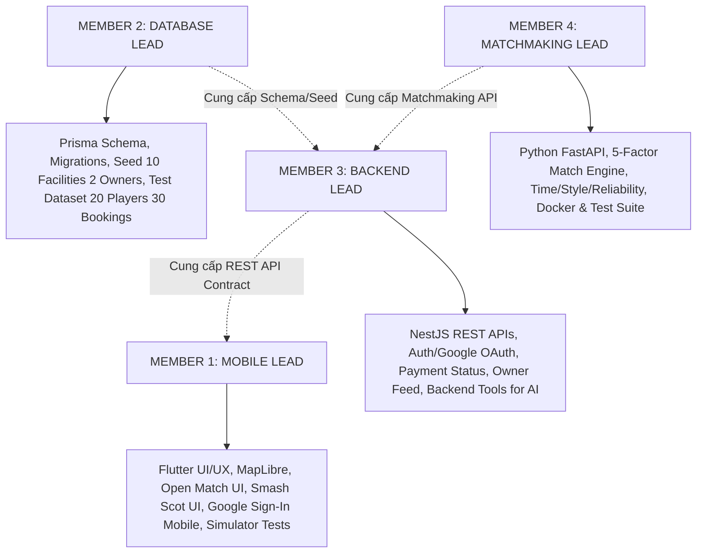
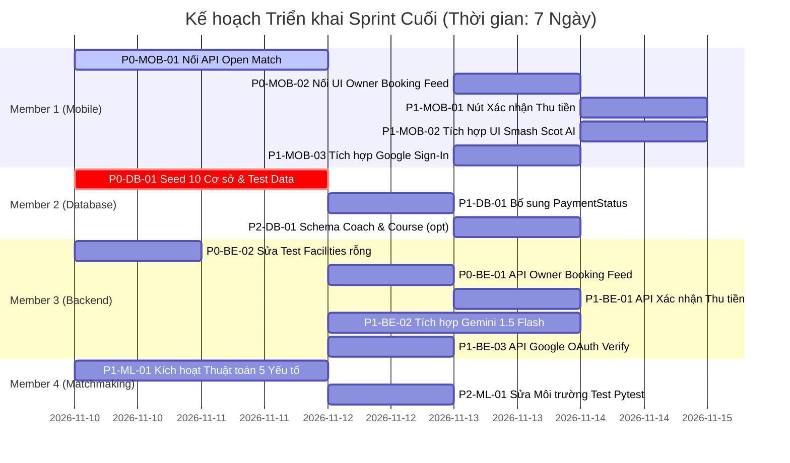

# DANH MỤC CÔNG VIỆC SPRINT CUỐI (FINAL SPRINT BACKLOG)
**S-Match Capstone Project — Task Distribution & Execution Plan**

> **Tài liệu bàn giao:** `docs/audits/S-MATCH-FINAL-SPRINT-BACKLOG.md`  
> **Thời điểm lập kế hoạch:** 09/11/2026  
> **Mục tiêu Sprint:** Đưa S-Match từ trạng thái *Demo tích hợp từng phần* thành *Ứng dụng vận hành trọn vẹn đầu-cuối (E2E Operational Application)* phục vụ bảo vệ đồ án tốt nghiệp Capstone.  
> **Quy mô nhóm:** 4 thành viên với vai trò chuyên trách rõ ràng.

---

## 1. PHÂN CÔNG VAI TRÒ NHÓM 4 THÀNH VIÊN

1. **Member 1 (Tôi - Mobile Lead):**
   - Chịu trách nhiệm toàn bộ mã nguồn Flutter: Giao diện, State Management (Riverpod), điều hướng và tích hợp Dio REST Client.
   - Nối luồng Open Match từ `MatchUiStore` sang API thật.
   - Nối giao diện danh sách booking cho Chủ sân (`GET /bookings/owner`).
   - Tích hợp `google_sign_in` trên mobile và dựng giao diện chat thông minh cho Smash Scot AI.
   - Đảm bảo ứng dụng chạy mượt mà trên iOS Simulator / Android Emulator.
2. **Member 2 (Database Lead):**
   - Chịu trách nhiệm về PostgreSQL và Prisma ORM: Thiết kế schema, tạo migration an toàn, viết script seed dữ liệu.
   - Bổ sung enum `PaymentStatus` và trường trạng thái thanh toán cho `Booking`.
   - Viết bộ seed chuẩn: 2 Chủ sân, 10 Cơ sở (6-4), 40 sân đấu, 20+ người chơi, 30 lượt đặt sân mẫu và 8 trận đấu giao lưu.
3. **Member 3 (Backend Lead - NestJS):**
   - Chịu trách nhiệm hệ thống REST API NestJS, Authentication & RBAC, phân quyền bảo mật.
   - Triển khai endpoint tiếp nhận Google ID Token (`POST /auth/google`).
   - Xây dựng API xác nhận thanh toán tại sân cho Chủ sân (`PATCH /bookings/:id/payment`).
   - Viết các API Tools cho AI Smash Scot truy vấn lịch sân trống và dữ liệu trận đấu.
4. **Member 4 (Matchmaking Lead - Python FastAPI):**
   - Chịu trách nhiệm dịch vụ Microservice Matchmaking (FastAPI).
   - Kích hoạt thuật toán 5 yếu tố từ `matcher.py` vào endpoint `/api/v1/match` (bổ sung thời gian rảnh, phong cách đánh và điểm uy tín).
   - Cài đặt đầy đủ dependencies (`numpy`, `pytest`) và đóng gói Docker container chuẩn.

---

## 2. BẢNG NHIỆM VỤ CHI TIẾT SPRINT CUỐI (DETAILED SPRINT BACKLOG)

### BẢNG NHÃN & KÝ HIỆU
- **P0 (Critical Blocker):** Bắt buộc phải hoàn thành trước tiên để các luồng vận hành cốt lõi chạy được.
- **P1 (Capstone Core):** Yêu cầu bắt buộc để đáp ứng cam kết đề cương đồ án và kịch bản bảo vệ.
- **P2 (Enhancement):** Tính năng tối ưu hóa nếu còn thời gian.

---

### GIAI ĐOẠN P0 — CÁC TÁC VỤ TIÊN QUYẾT (BLOCKERS)

| Task ID | Phân hệ | Hiện trạng | Công việc yêu cầu chi tiết | Phụ trách (Owner) | Phụ thuộc (Dependency) | Mức ưu tiên | Tiêu chí nghiệm thu (Acceptance Criteria) | Ước lượng |
| :---: | :--- | :--- | :--- | :---: | :---: | :---: | :--- | :---: |
| **P0-DB-01** | Database | Chỉ có 1 cơ sở, 0 booking, 0 match | Viết script `seed.ts` chuẩn: 2 Chủ sân (6 cơ sở Hải Châu/Sơn Trà & 4 cơ sở Ngũ Hành Sơn/Cẩm Lệ), 40 sân đấu, 20+ người chơi, 30 bookings, 8 matches | **Member 2 (DB)** | Không | **P0** | Chạy `npx prisma db seed` không lỗi; DB có đúng 10 cơ sở ID dương, 30 booking (10 quá khứ, 15 tương lai, 5 hủy), 8 trận đấu | 1.5 ngày |
| **P0-MOB-01**| Match | Mobile dùng `MatchUiStore` (RAM) | Viết `MatchRepository` trên Flutter sử dụng Dio Client, kết nối trực tiếp các endpoint NestJS: `POST /matches`, `GET /matches/open`, `POST /matches/:id/join`, `POST /matches/:id/requests/:userId/accept` | **Member 1 (Mobile)** | Backend API có sẵn | **P0** | Tạo trận trên Máy A ➔ Mở Máy B thấy trận xuất hiện ngay trên danh sách ➔ Bấm xin tham gia ➔ Máy A nhận được yêu cầu và bấm duyệt ➔ Cả 2 máy cập nhật danh sách người tham gia | 2 ngày |
| **P0-BE-01** | Booking / Owner | Backend vừa có `GET /bookings/owner`, Mobile chưa có UI | Viết API chi tiết lịch đặt sân cho Chủ sân kèm bộ lọc ngày và trạng thái. Cung cấp API cập nhật trạng thái thanh toán | **Member 3 (Backend)**| P0-DB-01 | **P0** | API trả về danh sách đặt sân của đúng các cơ sở thuộc quyền sở hữu của Owner đang đăng nhập | 1 ngày |
| **P0-MOB-02**| Booking / Owner | Màn hình Owner chưa có danh sách booking thật | Nối Riverpod StateNotifier vào `owner_dashboard_screen.dart` gọi `GET /bookings/owner`, hiển thị danh sách khách đặt sân trong ngày | **Member 1 (Mobile)** | P0-BE-01 | **P0** | Chủ sân đăng nhập thấy danh sách khách đã đặt sân hôm nay (tên khách, giờ chơi, sân số mấy, trạng thái đơn) | 1 ngày |
| **P0-BE-02** | Testing | File `facilities.service.spec.ts` rỗng 0 bytes gây fail Jest | Thêm unit test kiểm tra khởi tạo `FacilitiesService` và các method cơ bản | **Member 3 (Backend)**| Không | **P0** | Chạy `npm test` trong thư mục backend không còn bất kỳ lỗi `Your test suite must contain at least one test` | 0.5 ngày |

---

### GIAI ĐOẠN P1 — HOÀN THIỆN ĐỒ ÁN VÀ PHỤC VỤ BẢO VỆ CAPSTONE

| Task ID | Phân hệ | Hiện trạng | Công việc yêu cầu chi tiết | Phụ trách (Owner) | Phụ thuộc (Dependency) | Mức ưu tiên | Tiêu chí nghiệm thu (Acceptance Criteria) | Ước lượng |
| :---: | :--- | :--- | :--- | :---: | :---: | :---: | :--- | :---: |
| **P1-DB-01** | Finance | `Booking` chưa có `paymentStatus`, `collectedRevenue: null` | Thêm enum `PaymentStatus` (UNPAID, PAID, REFUNDED) và trường `paymentStatus` vào model `Booking`. Tạo migration Prisma an toàn | **Member 2 (DB)** | Không | **P1** | Schema có trường `paymentStatus`, default là UNPAID cho pay-at-court | 0.5 ngày |
| **P1-BE-01** | Finance | Chưa có endpoint thu tiền tại sân | Viết endpoint `PATCH /bookings/:id/payment-status` cho phép Chủ sân chuyển trạng thái sang PAID. Cập nhật `RevenueAnalyticsService` tính `collectedRevenue` dựa trên đơn PAID | **Member 3 (Backend)**| P1-DB-01 | **P1** | Bấm xác nhận thu tiền ➔ Đơn chuyển sang PAID ➔ Biểu đồ Analytics của Chủ sân cập nhật doanh thu thực thu (`collectedRevenue`) | 1 ngày |
| **P1-MOB-01**| Finance | Chủ sân không có nút xác nhận thu tiền | Thêm nút "Xác nhận đã thanh toán" trên từng item đặt sân trong màn hình quản lý của Chủ sân | **Member 1 (Mobile)** | P1-BE-01 | **P1** | Chủ sân bấm nút ➔ Gửi API cập nhật ➔ Badge đơn hàng đổi từ UNPAID sang PAID | 0.5 ngày |
| **P1-ML-01** | Matchmaking | `main.py` chỉ tính 2 yếu tố, bỏ quên `matcher.py` | Tái cấu trúc `matchmaking/app/main.py` gọi `MatchmakingEngine` từ `matcher.py`. Tính đủ điểm thời gian rảnh, phong cách đánh và điểm uy tín | **Member 4 (ML)** | Không | **P1** | API `/api/v1/match` trả về điểm match phản ánh đúng khung giờ rảnh và trình độ; breakdown đủ 5 yếu tố | 1.5 ngày |
| **P1-BE-02** | AI Smash Scot | Chưa có module AI trên Backend | Viết module `ai` trên NestJS tích hợp Google Gemini 1.5 Flash API qua official SDK. Cấu hình System Prompt am hiểu luật cầu lông BWF và đăng ký Tool Call: `findAvailableCourts`, `findOpenMatches` | **Member 3 (Backend)**| P0-DB-01 | **P1** | Endpoint `POST /ai/chat` nhận câu hỏi ➔ Gemini tự động gọi tool tra cứu database ➔ Trả lời chính xác lịch sân trống và trận đấu thực tế | 2 ngày |
| **P1-MOB-02**| AI Smash Scot | `smash_scot.dart` là if/else tĩnh | Thay thế hàm tĩnh bằng Riverpod StateNotifier gọi `POST /ai/chat`. Hiển thị tin nhắn dạng stream hoặc bong bóng chat sinh động | **Member 1 (Mobile)** | P1-BE-02 | **P1** | Người dùng hỏi: "Tối nay sân nào ở Hải Châu còn trống sau 19h?" ➔ AI trả lời chính xác tên sân và giờ trống từ database | 1 ngày |
| **P1-BE-03** | Auth | Chưa có endpoint nhận Google token | Tạo endpoint `POST /auth/google` trên NestJS. Sử dụng `google-auth-library` để verify ID Token từ Google, tìm hoặc tạo User với role PLAYER | **Member 3 (Backend)**| Không | **P1** | Gửi token hợp lệ ➔ Trả về JWT Access Token và Refresh Token của S-Match | 1 ngày |
| **P1-MOB-03**| Auth | Nút Google hiện SnackBar | Thêm package `google_sign_in` vào `pubspec.yaml`, cấu hình Client ID và gọi SDK lấy ID Token gửi lên Backend | **Member 1 (Mobile)** | P1-BE-03 | **P1** | Bấm nút Google ➔ Mở Google Account Selector ➔ Đăng nhập thành công và tự động chuyển vào Home Screen | 1 ngày |
| **P1-MOB-04**| Rating | Chưa có pop-up đánh giá sau trận | Thêm trigger kiểm tra trận đấu vừa hoàn thành, mở modal đánh giá người cùng chơi và gọi API `POST /ratings` | **Member 1 (Mobile)** | Không (API có sẵn)| **P1** | Sau khi host bấm hoàn thành trận, các thành viên mở app sẽ thấy modal đánh giá 1-5 sao và comment | 1 ngày |

---

### GIAI ĐOẠN P2 — NÂNG CAO & TỐI ƯU HÓA TRẢI NGHIỆM

| Task ID | Phân hệ | Hiện trạng | Công việc yêu cầu chi tiết | Phụ trách (Owner) | Phụ thuộc (Dependency) | Mức ưu tiên | Tiêu chí nghiệm thu (Acceptance Criteria) | Ước lượng |
| :---: | :--- | :--- | :--- | :---: | :---: | :---: | :--- | :---: |
| **P2-BE-01** | Auth | Quên mật khẩu dùng mã hardcode 2846 | Tích hợp Nodemailer / Resend gửi mã OTP 6 số ngẫu nhiên qua email thật của người dùng | **Member 3 (Backend)**| Không | **P2** | Nhập email ➔ Nhận được email có mã OTP thật có hiệu lực 5 phút | 1 ngày |
| **P2-MOB-01**| Auth | Nối API Quên mật khẩu thật | Nối màn hình `forgot_password_screen.dart` với API gửi mã và đặt lại mật khẩu của Backend | **Member 1 (Mobile)** | P2-BE-01 | **P2** | Người dùng nhận mã qua email, nhập vào app và đổi mật khẩu mới thành công | 0.5 ngày |
| **P2-DB-01** | Coach/Course | Dữ liệu HLV nằm tĩnh trong Flutter | Tạo bảng `Coach` và `Course` trong Prisma, chuyển dữ liệu từ `demo_catalog.dart` vào DB | **Member 2 (DB)** | Không | **P2** | Bảng Coach và Course có dữ liệu lưu trong PostgreSQL | 1 ngày |
| **P2-BE-02** | Coach/Course | Chưa có API khóa học và HLV | Viết API `GET /coaches` và `GET /courses` | **Member 3 (Backend)**| P2-DB-01 | **P2** | Mobile gọi API nạp danh sách HLV thay vì lấy từ demo catalog | 0.5 ngày |
| **P2-ML-01** | Matchmaking | Pytest cục bộ thiếu numpy | Cập nhật file `requirements.txt` và script khởi chạy môi trường test tự động cho FastAPI | **Member 4 (ML)** | Không | **P2** | Chạy `pytest test/` pass 100% không phụ thuộc Docker | 0.5 ngày |

---

## 3. SƠ ĐỒ ĐƯỜNG GĂNG TIẾN ĐỘ & TÍNH SONG SONG (CRITICAL PATH & PARALLEL EXECUTION)

### Các tác vụ có thể chạy song song ngay từ Ngày 1:
1. **Member 1 (Mobile)** làm ngay `P0-MOB-01` (Nối Open Match API): Do Backend NestJS đã có sẵn toàn bộ controller `/matches`, Mobile Lead có thể bắt tay viết Dio repository ngay mà không cần đợi ai.
2. **Member 2 (Database)** làm ngay `P0-DB-01` (Viết bộ Seed Data 10 cơ sở, 2 chủ sân, 30 booking): Độc lập hoàn toàn.
3. **Member 3 (Backend)** sửa ngay `P0-BE-02` (File test rỗng) và chuẩn bị Google Auth `P1-BE-03`.
4. **Member 4 (Matchmaking)** làm ngay `P1-ML-01` (Kích hoạt thuật toán 5 yếu tố trong Python): Độc lập trong thư mục `matchmaking/`.

### Các điểm nghẽn phụ thuộc (Dependencies):
- `P0-MOB-02` (UI Owner Feed) phải đợi `P0-BE-01` (API Owner Booking Feed).
- `P1-BE-01` (API Thu tiền) phải đợi `P1-DB-01` (Migration enum `PaymentStatus`).
- `P1-MOB-02` (UI Smash Scot AI) phải đợi `P1-BE-02` (NestJS Gemini Tool Calling API).

---

## 4. CHIẾN LƯỢC QUẢN LÝ RỦI RO & PHÒNG NGỪA PHÁ VỠ MÃ NGUỒN

1. **Quy tắc Git Branching an toàn:**
   - Mỗi thành viên tạo feature branch riêng từ `develop`:
     - `feature/P0-open-match-mobile` (Member 1)
     - `feature/P0-seed-10-facilities` (Member 2)
     - `feature/P0-owner-feed-payment` (Member 3)
     - `feature/P1-matchmaking-5-factor` (Member 4)
   - Bắt buộc kiểm tra `npm test` và `flutter analyze` trước khi mở Pull Request vào `develop`.
2. **Quy tắc Cơ sở dữ liệu:**
   - Tuyệt đối không chạy lệnh `prisma migrate reset` trên database dùng chung.
   - Các migration chỉ được thêm mới (Additive Migration), không drop cột hay đổi tên cột đang có dữ liệu.
3. **Kế hoạch Dự phòng cho Buổi Bảo vệ (Defense Fallback Plan):**
   - Nếu SMS OTP quá phức tạp để đăng ký Brandname: Thống nhất chuyển sang P2, tập trung demo Email/Password và Google Sign-In.
   - Nếu internet tại hội đồng bảo vệ chập chờn: Luôn chuẩn bị sẵn môi trường Docker Compose chạy trọn bộ (PostgreSQL, NestJS, FastAPI) trực tiếp trên máy tính cá nhân (Localhost Demo).

---
*Kế hoạch được lập chính thức tại `docs/audits/S-MATCH-FINAL-SPRINT-BACKLOG.md`.*

